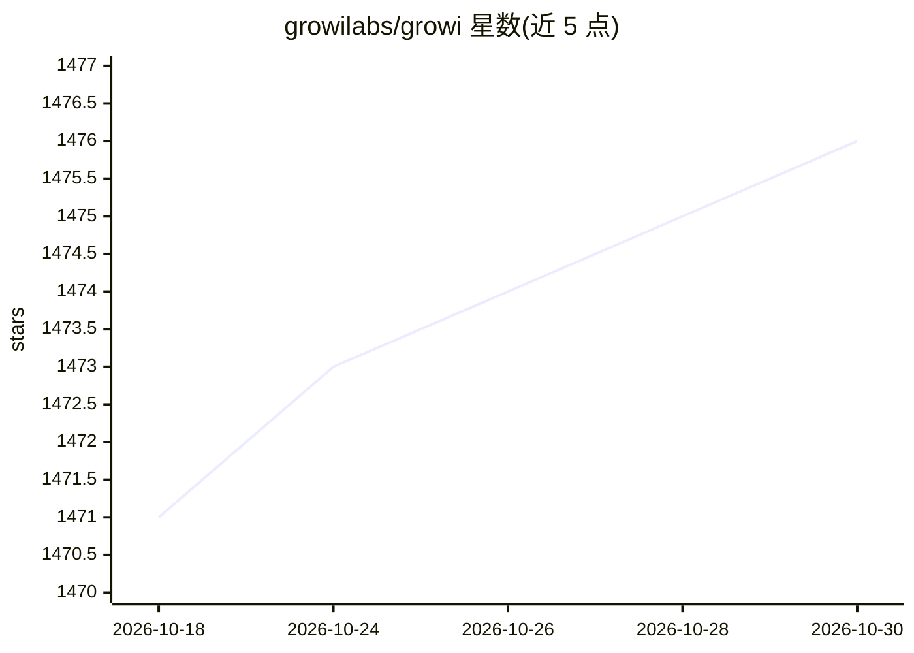

# growilabs/growi

⭐ 1,476 · TypeScript · MIT · 推送 2026-10-29 · [GitHub](https://github.com/growilabs/growi) · [官网](https://growi.org) · 组织维护

**团队协作用 Markdown Wiki / 知识库软件**

GROWI 是基于 Node.js/React/TypeScript 的团队协作 wiki 软件：以 Markdown 编辑层级页面，支持多人同时编辑、LDAP/AD/OAuth 认证、SAML 单点登录、Slack/Mattermost/IFTTT 集成与插件机制。部署方式包括 docker-compose、Helm Chart（实验性）与 on-premise 安装。开发依赖 Node.js v24、pnpm 11、Turborepo、MongoDB；可选 Redis 与 ElasticSearch（全文搜索，需 kuromoji/ICU 插件）。MIT 许可。

## 筛选速览

| 维度 | 判定 | 备注 |
|---|---|---|
| AI 角色 | `ai-enhanced` | 去掉 AI 部分产品仍成立 |
| 许可风险 | `permissive` | MIT |
| 部署形态 | `self-host` | docker 或自建部署 |
| 模型依赖 | — | README 未给出锁定关系 |
| 硬件要求 | — | 无带数字的原话,不猜 |
| 安装摩擦 | `low` | 无编译、无系统依赖或容器化 |
| 成熟度 | `idea` | |

## 能力要点

- Markdown 层级页面与多人同时编辑
- LDAP/Active Directory/OAuth 认证与 SAML SSO
- Slack/Mattermost/IFTTT 集成与 npm/GitHub 插件机制
- Docker 与 Docker Compose 部署支持

## 适用场景

- 团队搭建内部知识库与文档 wiki
- 企业内通过 SSO 集成统一认证访问 wiki
- 以 Docker Compose 快速部署协作站点

## 场景标签

`知识库管理` · 领域:知识与检索

## 证据(README 行号)

> L12: # GROWI
> L27:  - Create hierarchical pages with markdown -> Try GROWI on the demo site

## 星数曲线

2026-10-18 1,471 → 2026-10-30 1,476（+5）

---
*卡片 v1 · prompt 1.4 · 生成 2026-10-21 · 置信度 mid · 依据 README sha `d7622ca2ffa0` · [字段定义](../../DATASET.md)*
