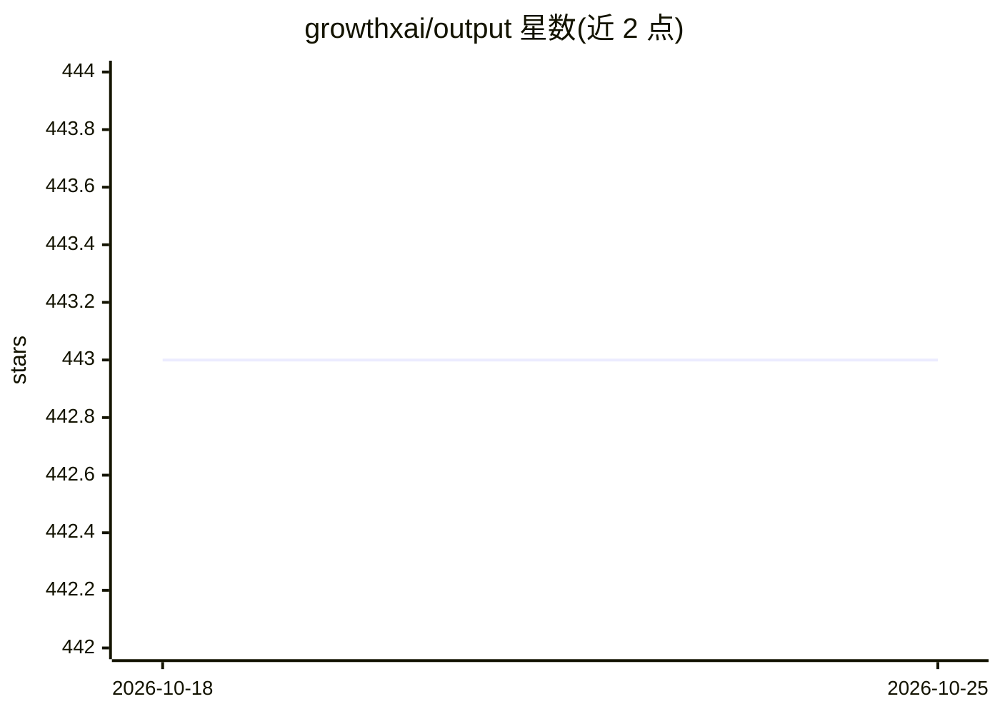

# growthxai/output

⭐ 443 · JavaScript · Apache-2.0 · 推送 2026-10-22 · [GitHub](https://github.com/growthxai/output) · [官网](https://output.ai) · 组织维护

**TypeScript AI 工作流与 Agent 开发框架，面向 Claude Code 协作**

开源 TypeScript 框架，用于构建 AI 工作流与 agent，代码结构面向 AI 编程助手（Claude Code）可读写，每个工作流是一个包含代码、提示词、测试、评测与追踪的文件夹。提供多 provider LLM 统一 API（Anthropic/OpenAI/Azure/Vertex/Bedrock）、.prompt 文件提示词管理、自动追踪（token/成本/延迟）、LLM-as-judge 评测、基于 Temporal 的编排与重试，以及 AES-256-GCM 凭证加密。通过 npm CLI（npx @outputai/cli init）安装，要求 Node.js 20+、Docker Desktop 与 LLM API key，附带 9 个示例工作流。

## 筛选速览

| 维度 | 判定 | 备注 |
|---|---|---|
| AI 角色 | `ai-ecosystem` | LLM/agent 周边工具 |
| 许可风险 | `permissive` | Apache-2.0 |
| 部署形态 | `library` | 以包/库形式分发 |
| 模型依赖 | locked-api |  |
| 硬件要求 | — | 无带数字的原话,不猜 |
| 安装摩擦 | `low` | 无编译、无系统依赖或容器化 |
| 成熟度 | — | 结构信号不足 |

## 能力要点

- 多 provider 统一 API：Anthropic/OpenAI/Azure/Vertex AI/Bedrock，一行切换
- 自动追踪每次 LLM 调用与 HTTP 请求（token、成本、延迟，JSON 落盘）
- Temporal 驱动的编排：自动重试、故障重放、子工作流、并发控制
- .prompt 文件（YAML frontmatter + Liquid 模板）版本化管理提示词

## 适用场景

- 用 TypeScript 构建 LLM 工作流与 agent，并由 AI 编程助手代为生成迭代
- 对 LLM 调用做成本追踪、追踪分析与评测
- 在本地运行生产级示例工作流（网页摘要、YouTube 摘要、变更日志生成等）

## 场景标签

`Agent 框架` `工作流自动化` `提示工程` `模型评测` · 领域:Agent 开发

## 证据(README 行号)

> L9: The open-source TypeScript framework for building AI workflows and agents. Designed for Claude Code — describe what 
> L41: Anthropic, OpenAI, Azure, Vertex AI, Bedrock. One API. Structured outputs, streaming, tool calling — all work the s
> L45: Temporal under the hood. Automatic retries with exponential backoff. Workflow history. Replay on failure. Child wor

## 星数曲线

2026-10-18 443 → 2026-10-25 443（+0）

---
*卡片 v1 · prompt 1.4 · 生成 2026-10-21 · 置信度 high · 依据 README sha `0f0a14d40e3d` · [字段定义](../../DATASET.md)*
