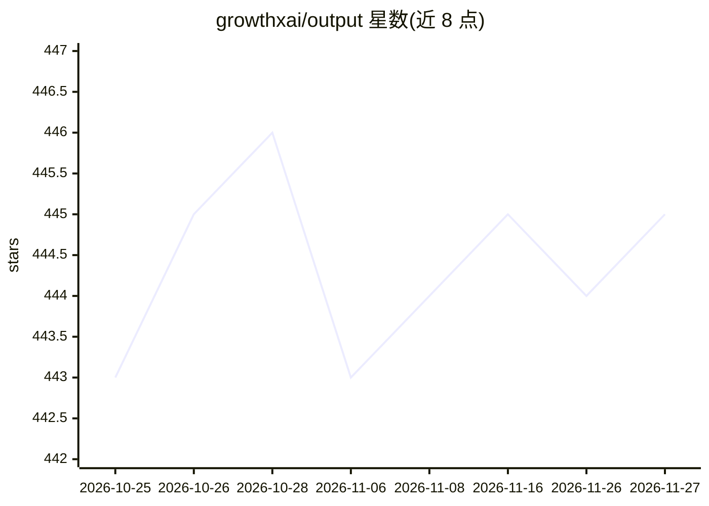

# growthxai/output

⭐ 445 · JavaScript · Apache-2.0 · 推送 2026-11-26 · [GitHub](https://github.com/growthxai/output) · [官网](https://output.ai) · 组织维护

**TypeScript AI 工作流与 agent 构建框架，为 Claude Code 设计**

将 prompt 管理、评测、追踪、成本记录、编排与凭证管理整合为单一 TypeScript 框架，避免分散的 SaaS 订阅。每个工作流是一个文件夹，包含代码、prompt、测试、评测与追踪，供 AI 编码 agent 读取完整上下文。底层使用 Temporal 提供自动重试、工作流历史与并行执行；凭证经 AES-256-GCM 加密。需 Node.js 20+、Docker Desktop 与 LLM API key，通过 @outputai/cli 初始化与运行。

## 筛选速览

| 维度 | 判定 | 备注 |
|---|---|---|
| AI 角色 | `ai-ecosystem` | LLM/agent 周边工具 |
| 许可风险 | `permissive` | Apache-2.0 |
| 部署形态 | `library` | 以包/库形式分发 |
| 模型依赖 | — | README 未给出锁定关系 |
| 硬件要求 | — | 无带数字的原话,不猜 |
| 安装摩擦 | `low` | 无编译、无系统依赖或容器化 |
| 成熟度 | — | 结构信号不足 |

## 能力要点

- .prompt 文件（YAML frontmatter + Liquid 模板）纳入版本控制与 PR 评审
- 自动追踪每次 LLM 调用的 token、成本、延迟并以 JSON 写入本地 logs/runs/
- LLM-as-judge 评测器：置信度评分、线上重试与离线数据集评测
- 内置 Temporal：指数退避重试、失败重放、子工作流与并发控制

## 适用场景

- 用 Claude Code 脚手架并迭代生成 AI 工作流代码
- 在自有代码库中管理 prompt 版本与多供应商切换
- 为生产 LLM 流程建立追踪、成本与评测基线
- 运行可 fork 的示例工作流（博客评测、销售通话打分、订阅摘要等）

## 场景标签

`工作流自动化` `Agent 框架` `LLM 可观测性` · 领域:Agent 开发

## 证据(README 行号)

> L9: The open-source TypeScript framework for building AI workflows and agents. Designed for Claude Code — describe what 
> L25: Output is the first framework designed for AI coding agents. The entire codebase is structured so Claude Code can s
> L41: Anthropic, OpenAI, Azure, Vertex AI, Bedrock. One API. Structured outputs, streaming, tool calling — all work the s

## 星数曲线

2026-10-25 443 → 2026-11-27 445（+2）

---
*卡片 v1 · prompt 1.4 · 生成 2026-11-25 · 置信度 high · 依据 README sha `ce415acd35b8` · [字段定义](../../DATASET.md)*
