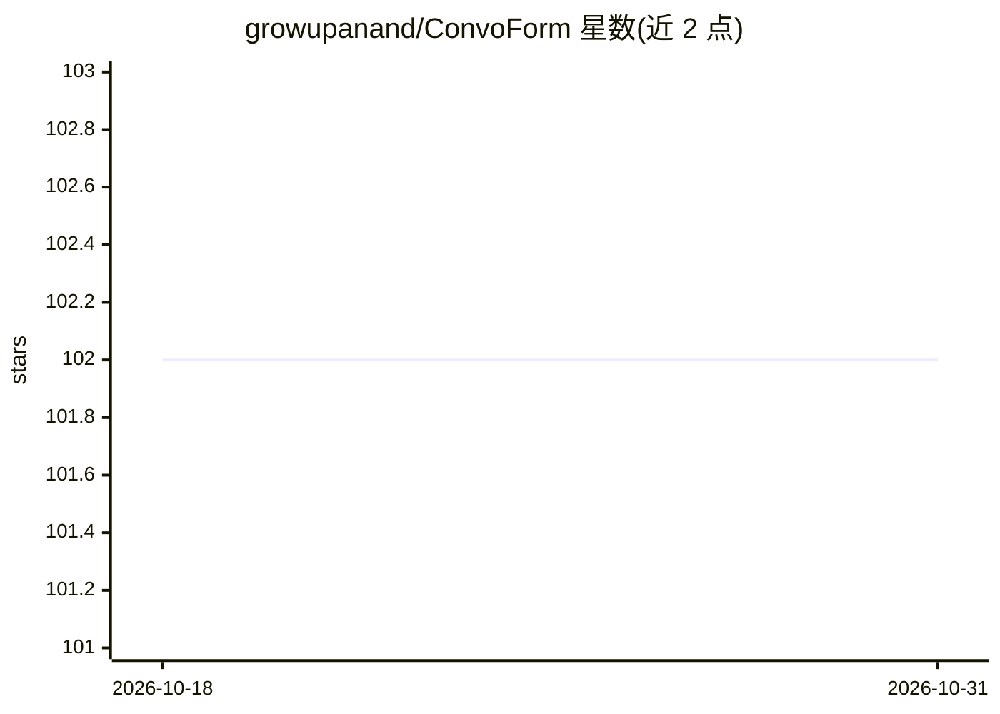

# growupanand/ConvoForm

⭐ 102 · TypeScript · Apache-2.0 · 推送 2026-10-30 · [GitHub](https://github.com/growupanand/ConvoForm) · [官网](https://convoform.com) · 个人维护

**把传统表单转成 AI 对话式数据收集的开源表单工具**

基于 Next.js/Turborepo 的表单产品：用户用自然语言描述需求由 AI 生成表单，填写者以聊天对话形式回答问题，AI 实时校验回答并追问，另提供实时编辑器与提交页品牌定制。面向需要数据收集的建站/产品团队，支持自托管。技术栈含 PostgreSQL、Drizzle ORM、tRPC、Clerk 认证、Resend 邮件，并带 websocket 服务与 Telegram webhook 渠道服务；本地运行需 Node.js v22+、pnpm、Bun 与 PostgreSQL。

## 筛选速览

| 维度 | 判定 | 备注 |
|---|---|---|
| AI 角色 | `ai-enhanced` | 去掉 AI 部分产品仍成立 |
| 许可风险 | `permissive` | Apache-2.0 |
| 部署形态 | `library` | 以包/库形式分发 |
| 模型依赖 | — | README 未给出锁定关系 |
| 硬件要求 | — | 无带数字的原话,不猜 |
| 安装摩擦 | `low` | 无编译、无系统依赖或容器化 |
| 成熟度 | — | 结构信号不足 |

## 能力要点

- 自然语言描述需求由 AI 生成表单
- 对话式答题界面与 AI 实时校验追问
- 表单实时编辑器与提交页品牌定制
- 提供自托管路径与文档站（Apache 2.0 开源）

## 适用场景

- 用 AI 快速生成调查或报名表单
- 以聊天对话方式收集用户回答并自动校验
- 自托管部署到自己的服务器与数据库

## 场景标签

 · 领域:表单/数据收集

## 证据(README 行号)

> L12: ConvoForm transforms traditional, static forms into interactive, AI-powered conversational experiences. It makes da
> L16: - **AI-Powered Generation**: Describe your needs, and let AI build the form for you.

## 星数曲线

2026-10-18 102 → 2026-10-31 102（+0）

---
*卡片 v1 · prompt 1.4 · 生成 2026-10-23 · 置信度 low · 依据 README sha `8099ec023896` · [字段定义](../../DATASET.md)*
