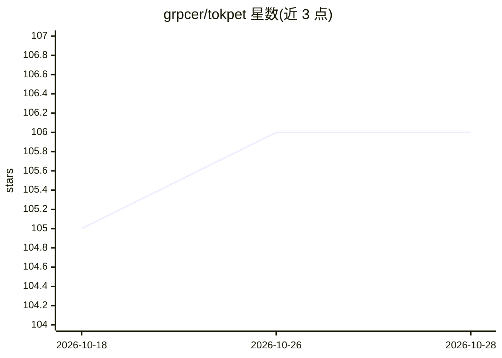

# grpcer/tokpet

⭐ 106 · C · Apache-2.0 · 推送 2026-06-30 · [GitHub](https://github.com/grpcer/tokpet) · [官网](https://www.npmjs.com/package/tokpet) · 组织维护 · 中文 README

**把各 AI 服务用量/余额聚合成一个本地桌面宠物显示**

本地 Node.js 伴随服务（npm 包 tokpet）：轮询已连接的 AI 提供商（当前支持 Claude、Codex 订阅滚动用量与 DeepSeek API-key 余额），将不同计费模型归一化为统一的 GET /state JSON 契约，在局域网内提供只读数据源；浏览器控制台即为完整客户端，另有 ESP32-S3 圆屏桌面宠物固件通过 mDNS 发现并轮询该数据源，按用量映射 chill/alert/stress 情绪显示。本地优先，配置接口仅绑定回环。可通过 Homebrew 或 npm 安装。

## 筛选速览

| 维度 | 判定 | 备注 |
|---|---|---|
| AI 角色 | `ai-ecosystem` | LLM/agent 周边工具 |
| 许可风险 | `permissive` | Apache-2.0 |
| 部署形态 | `library` | 以包/库形式分发 |
| 模型依赖 | locked-api |  |
| 硬件要求 | — | 无带数字的原话,不猜 |
| 安装摩擦 | `low` | 无编译、无系统依赖或容器化 |
| 成熟度 | `idea` | |

## 能力要点

- 多提供商用量归一化为单一版本化 /state 契约
- 浏览器控制台即可完整使用，无需硬件
- mDNS 零配置发现，ESP32-S3 固件含圆屏 AMOLED 显示
- 提供商以目录+注册表方式可插拔扩展

## 适用场景

- 在桌面宠物或浏览器一眼查看多个 AI 服务的剩余额度
- DIY ESP32 桌面硬件显示自己的 AI 用量压力
- 通过 /state 契约自建第三方显示客户端

## 场景标签

`LLM 可观测性` · 领域:评测与运维

## 证据(README 行号)

> L7: Tokpet is a tiny companion service that reads your real-time usage from every AI
> L34: - **The companion** — a small Node.js service (this repo, published as the npm
> L72: The companion polls each activated provider, maps its data onto a common

## 星数曲线

2026-10-18 105 → 2026-10-28 106（+1）

---
*卡片 v1 · prompt 1.4 · 生成 2026-10-23 · 置信度 high · 依据 README sha `dd87b1978b8c` · [字段定义](../../DATASET.md)*
