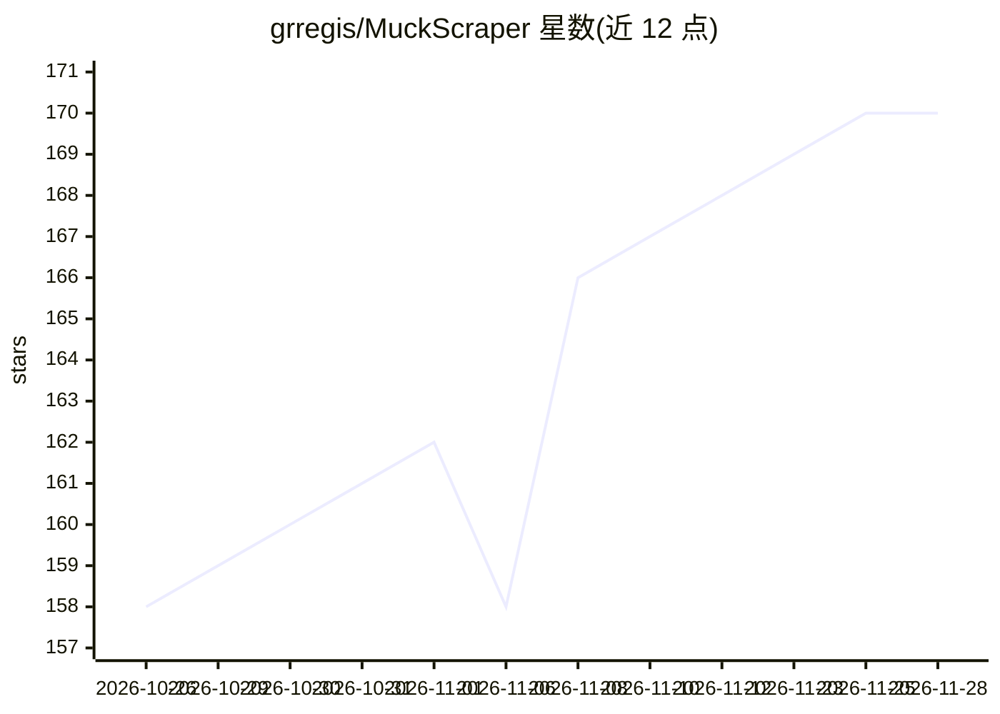

# grregis/MuckScraper

⭐ 170 · Python · MIT · 推送 2026-11-20 · [GitHub](https://github.com/grregis/MuckScraper) · [官网](https://sample.muckscraper.news) · 个人维护

**自托管新闻聚合器：分组报道并本地 LLM 偏见分析与摘要**

以 Docker 部署在自有硬件上的新闻聚合管道：定时从 RSS（可选 NewsAPI/GNews）抓取文章，用嵌入（nomic-embed-text + pgvector）将多源同类报道归并为单一故事，为每个故事生成摘要、左右翼覆盖对比和深度报告；媒体源带有 AllSides 与模型给出的偏见评级，社论单独归类。默认使用本地 Ollama 运行 LLM，也可切换 Gemini/Groq 等 OpenAI 兼容端点；含登录体系、三档用户角色与可选 MCP 服务器供 AI 助手查询运行状态。

## 筛选速览

| 维度 | 判定 | 备注 |
|---|---|---|
| AI 角色 | `ai-native` | 本体是模型或模型工具 |
| 许可风险 | `permissive` | MIT |
| 部署形态 | `self-host` | docker 或自建部署 |
| 模型依赖 | local-ok | 支持本地模型 |
| 硬件要求 | — | 无带数字的原话,不猜 |
| 安装摩擦 | `low` | 无编译、无系统依赖或容器化 |
| 成熟度 | — | 结构信号不足 |

## 能力要点

- 多源文章按嵌入相似度归并成单一故事，重复报道与通稿合并计数
- 每篇故事呈现左/中/右各派覆盖对比，并可一键补抓缺失立场的报道
- 默认本地 Ollama 运行 LLM 与嵌入，支持 Gemini/Groq/OpenAI 兼容端点
- 提供可选 MCP 服务器，让 AI 助手只读查询安装状态

## 适用场景

- 在自有服务器上聚合多来源新闻，避免同一事件读十几遍
- 查看同一事件在不同政治立场媒体上的报道差异
- 本地运行 LLM 分析媒体偏见，数据留在自己机器上

## 场景标签

`语义搜索` · 领域:知识与检索

## 证据(README 行号)

> L5: > **TL;DR:** MuckScraper pulls news from multiple sources, groups related articles into stories, scores outlet bias,
> L20: - **One story, every outlet.** Each new article is turned into an embedding (`nomic-embed-text`, stored in pgvector
> L68: - **LLM Runtime:** Ollama by default; Gemini, Groq, or any OpenAI-compatible endpoint optional

## 星数曲线

2026-10-26 158 → 2026-11-28 170（+12）

---
*卡片 v1 · prompt 1.4 · 生成 2026-11-26 · 置信度 high · 依据 README sha `b30b9e9c7bcc` · [字段定义](../../DATASET.md)*
