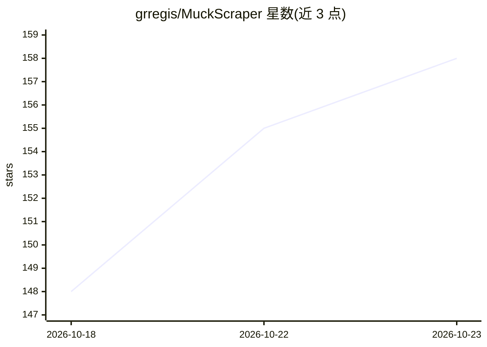

# grregis/MuckScraper

⭐ 158 · Python · MIT · 推送 2026-10-22 · [GitHub](https://github.com/grregis/MuckScraper) · 个人维护

**自托管新闻聚合器：多源归并成故事并用本地 LLM 做摘要与偏向评分**

用 Docker 部署于自有硬件的新闻聚合系统：按计划从 RSS（及可选 NewsAPI/GNews）抓取文章，用 nomic-embed-text 嵌入（存入 pgvector）将同一事件的多家报道归并为一个故事，LLM 生成摘要与深度报告，展示左/中/右媒体覆盖计数，媒体偏向评级来自 AllSides 或模型推断；社论与新闻分开存放，每日两次出版 20 条故事的平衡版次。LLM 运行时默认 Ollama，可选 Gemini/Groq/任意 OpenAI 兼容端点。定位为私有管理工具，不建议直接暴露公网。

## 筛选速览

| 维度 | 判定 | 备注 |
|---|---|---|
| AI 角色 | `ai-native` | 本体是模型或模型工具 |
| 许可风险 | `permissive` | MIT |
| 部署形态 | `self-host` | docker 或自建部署 |
| 模型依赖 | local-ok | 支持本地模型 |
| 硬件要求 | — | 无带数字的原话,不猜 |
| 安装摩擦 | `low` | 无编译、无系统依赖或容器化 |
| 成熟度 | — | 结构信号不足 |

## 能力要点

- 嵌入比对 + 模型判定将同一事件的多篇报道归并为单故事
- 每故事显示左/中/右媒体覆盖计数，偏向评级来自 AllSides 或模型
- Ollama 默认本地推理，无需订阅，阅读记录留在本机
- 每日定时出版 20 条故事的平衡版次，历史版次可读

## 适用场景

- 在自己服务器上聚合多来源新闻并按故事阅读
- 查看同一事件在不同政治倾向媒体的报道差异
- 本地运行 LLM 生成新闻摘要与深度对比报告

## 场景标签

`网页抓取` `AI 写作` · 领域:效率与自动化

## 证据(README 行号)

> L5: > **TL;DR:** MuckScraper pulls news from multiple sources, groups related articles into stories, scores outlet bias,
> L22: - **Summaries of real reporting.** The model summarizes and compares articles that reporters wrote; it never writes
> L68: - **LLM Runtime:** Ollama by default; Gemini, Groq, or any OpenAI-compatible endpoint optional

## 星数曲线

2026-10-18 148 → 2026-10-23 158（+10）

---
*卡片 v1 · prompt 1.4 · 生成 2026-10-22 · 置信度 high · 依据 README sha `b579a46b3d5d` · [字段定义](../../DATASET.md)*
