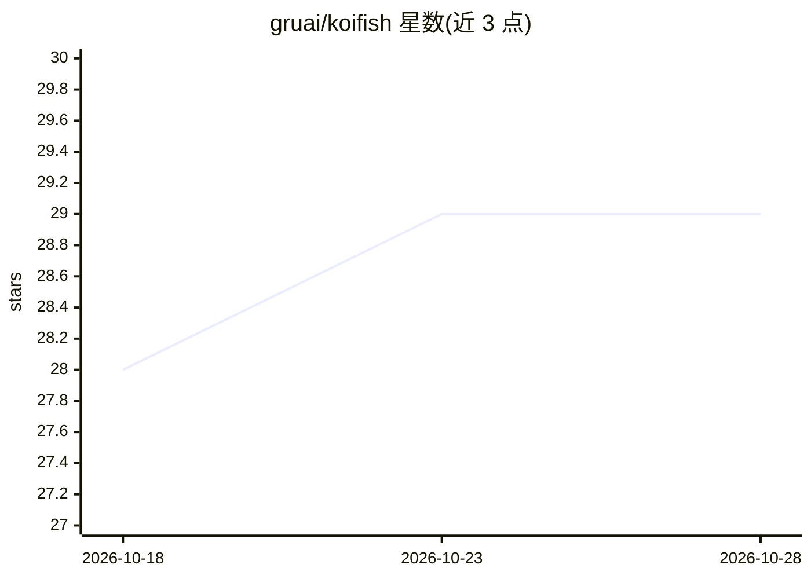

# gruai/koifish

⭐ 29 · C++ · Apache-2.0 · 推送 2026-10-17 · [GitHub](https://github.com/gruai/koifish) · 个人维护 · 中文 README

**C++/CUDA 实现的稀疏量化 LLM 训练与推理框架**

自包含的 C++/CUDA 深度学习框架，面向 LLM 的预训练（CPT）、微调（SFT/DPO）与推理，主打低资源：README 给出单张 4090 上数小时微调 4~32B 模型、约一天训练 ~2B 模型的数据（GPT2 系列实测表）。支持 AR 模型与掩码扩散语言模型（MDLM）、16/8/4/2/1 混合比特训练、专家演化优化（EOE）、训练不稳定自动检测。推理 CPU 版无需第三方库；训练需 CUDA 12.5+、cuDNN 及支持 FP8（计算能力 8.9+）的 16GB+ 显存 GPU，从源码编译构建。

## 筛选速览

| 维度 | 判定 | 备注 |
|---|---|---|
| AI 角色 | `ai-ecosystem` | LLM/agent 周边工具 |
| 许可风险 | `permissive` | Apache-2.0 |
| 部署形态 | `None` |  |
| 模型依赖 | — | README 未给出锁定关系 |
| 硬件要求 | — | 无带数字的原话,不猜 |
| 安装摩擦 | `medium` | 含编译或系统依赖之一 |
| 成熟度 | — | 结构信号不足 |

## 能力要点

- 支持 AR 与掩码扩散语言模型（MDLM）训练
- 16/8/4/2/1 bit 混合精度训练与量化推理
- 单张 4090 训练/微调（Qwen3-0.6B 训练、Qwen3-32B 推理）
- 自包含 C++/cu 项目，CPU 推理模块零第三方依赖

## 适用场景

- 在单张消费级 GPU 上做 LLM 预训练或微调
- 低显存环境下运行大模型量化推理
- 研究扩散语言模型与低比特训练算法

## 场景标签

`模型训练` `微调` `推理引擎` `模型量化` · 领域:训练与推理

## 证据(README 行号)

> L3: Sparse & quantized LLM training/inference/CPT/SFT/DPO.
> L20: - Support both Masked diffusion language models (MDLMs) and AR models

## 星数曲线

2026-10-18 28 → 2026-10-28 29（+1）

---
*卡片 v1 · prompt 1.4 · 生成 2026-10-26 · 置信度 high · 依据 README sha `940a724cafc8` · [字段定义](../../DATASET.md)*
