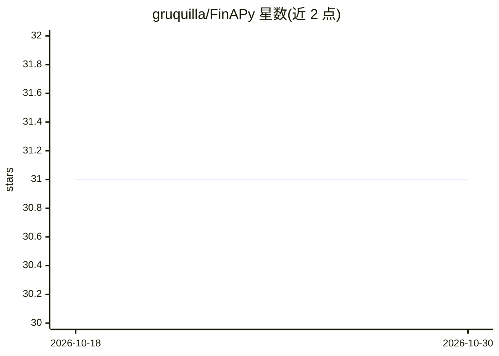

# gruquilla/FinAPy

⭐ 31 · Jupyter Notebook · 推送 2026-09-21 · [GitHub](https://github.com/gruquilla/FinAPy) · 个人维护

**本地化单只股票基本面与价格分析笔记本（LSTM+Ollama）**

以 Jupyter Notebook 形式提供的单只股票研究项目：输入 ticker 后从 Yahoo Finance 与 Google RSS 抓取数据，生成公司概览、K线图与统计指标、60 天 LSTM 价格预测（基线/乐观/悲观三情景）、FinBERT 新闻情感分析，以及基于三年财报的盈利/资产/流动性/偿债/运营比率计算与 Altman Z-score 等。AI 解读部分通过本地 Ollama 运行 gpt-oss-20b，不向外部服务器发送数据。预测不纳入宏观因素；AI 功能需 8GB 显存独显与 16GB 内存，否则可无 AI 模式运行。限教育与科研用途，CC BY-NC-SA 许可。

## 筛选速览

| 维度 | 判定 | 备注 |
|---|---|---|
| AI 角色 | `ai-native` | 本体是模型或模型工具 |
| 许可风险 | `none` | — |
| 部署形态 | `None` |  |
| 模型依赖 | local-ok | 支持本地模型 |
| 硬件要求 | — | 无带数字的原话,不猜 |
| 安装摩擦 | `low` | 无编译、无系统依赖或容器化 |
| 成熟度 | — | 结构信号不足 |

## 能力要点

- 60 天 LSTM 价格预测（三情景），基于最近 100 条收盘/最高/最低价训练
- 本地 Ollama + gpt-oss-20b 生成市场数据与财务比率的 AI 解读
- FinBERT 对抓取新闻做情感分析
- 三年财报比率分析与 Altman Z-score / Ohlson O-score 破产评分

## 适用场景

- 学生或研究者可视化某只股票的比率与市场数据
- CFA 备考者对照课程概念查看真实数据的偏度/峰度等
- 在本地高保密性地运行带 AI 解读的财务分析

## 场景标签

`科研工具` `金融量化` · 领域:学习与行业

## 证据(README 行号)

> L19: FinAPY (FINancial Analysis with PYthon) is a research project using Python that aims to provide a synthetic and yet
> L28:  * An optional AI analysis (using Ollama and GPT OSS:20B) that provides additional insight and interpretation in on

## 星数曲线

2026-10-18 31 → 2026-10-30 31（+0）

---
*卡片 v1 · prompt 1.4 · 生成 2026-10-26 · 置信度 high · 依据 README sha `7b2255133bbe` · [字段定义](../../DATASET.md)*
