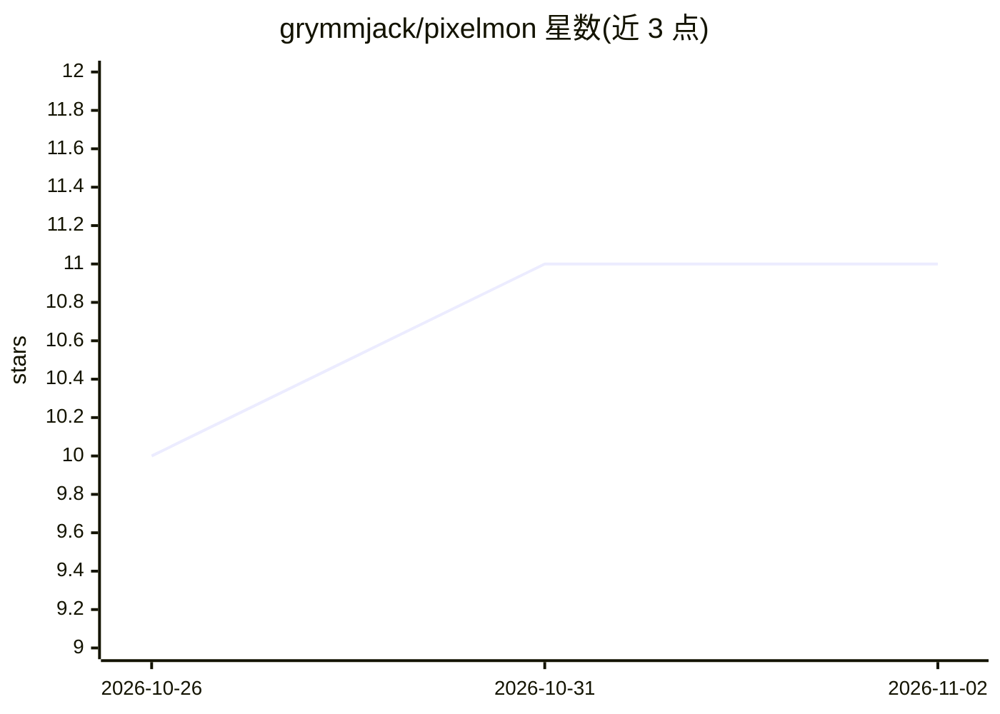

# grymmjack/pixelmon

⭐ 11 · Python · MIT · 推送 2026-10-29 · [GitHub](https://github.com/grymmjack/pixelmon) · 个人维护

**面向游戏开发者的像素画精灵生成 CLI（SDXL + Pixel Art XL）**

构建在本地 ComfyUI + SDXL + Pixel Art XL LoRA 之上的命令行工具：输入文本提示生成调色板锁定的像素画精灵，支持 55 种内置调色板、13 种抖动、38 种风格、img2img/ControlNet 编辑、透明抠图（BiRefNet）、Hunyuan3D 2 生成 3D 模型、批处理与多 GPU 渲染农场，另带浏览器 GUI 与 65 个出厂预设。安装脚本自动检测 NVIDIA CUDA / AMD ROCm / Apple MPS / CPU 并配置环境。限制：CPU 路径速度很慢，动画功能为实验性。

## 筛选速览

| 维度 | 判定 | 备注 |
|---|---|---|
| AI 角色 | `ai-native` | 本体是模型或模型工具 |
| 许可风险 | `permissive` | MIT |
| 部署形态 | `None` |  |
| 模型依赖 | — | README 未给出锁定关系 |
| 硬件要求 | — | 无带数字的原话,不猜 |
| 安装摩擦 | `medium` | 含编译或系统依赖之一 |
| 成熟度 | `idea` | |

## 能力要点

- SDXL + Pixel Art XL LoRA 生成真降采样、调色板锁定的像素精灵
- 55 种调色板（PICO-8/NES/EGA/C64 等）+ 13 种抖动 + 38 种风格
- img2img / IPAdapter 图像引导 / ControlNet 转像素画 / BiRefNet 抠图
- 多 GPU 渲染农场与 --server 远程提交渲染
- 附带浏览器 GUI（pixelmon-gui）与 65 个出厂预设

## 适用场景

- 为我的游戏批量生成整套像素画精灵/贴图
- 把已有图片转成像素风并保持参考构图
- 用特定复古硬件调色板（Game Boy/EGA/C64）生成素材
- 在多台 GPU 机器上分布式渲染素材清单

## 场景标签

`图像生成` · 领域:内容生成

## 证据(README 行号)

> L3: Generate game-ready pixel-art sprites from a text prompt with **one command**,
> L112: A thin, friendly CLI (`pixelmon`) over a local **ComfyUI** server, plus a custom

## 星数曲线

2026-10-26 10 → 2026-11-02 11（+1）

---
*卡片 v1 · prompt 1.4 · 生成 2026-11-02 · 置信度 high · 依据 README sha `a1132651f7eb` · [字段定义](../../DATASET.md)*
