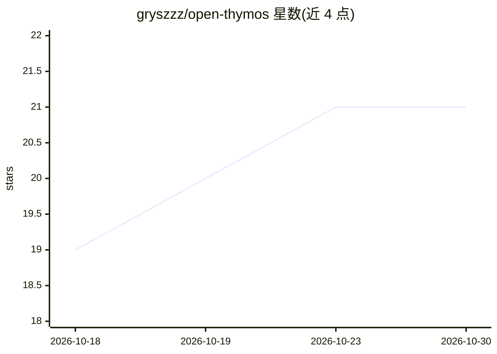

# gryszzz/open-thymos

⭐ 21 · Rust · Apache-2.0 · 推送 2026-09-30 · [GitHub](https://github.com/gryszzz/open-thymos) · [官网](https://gryszzz.github.io/open-thymos/) · 个人维护

**AI agent 沙箱治理运行时：对每个动作做授权、审计与可重放**

面向需要约束 AI agent 行为的开发者与平台：提供 Rust 实现的运行时与桌面应用，把认知输出视为不可信输入，所有动作经 Intent → Proposal → Commit 流程，由 ed25519 签名的能力令状限定工具范围、效果上限、预算与时间窗，结果写入哈希链式只追加账本，支持确定性重放、M-of-N 审批、撤销与补偿回滚。可连接 Claude、OpenAI、Ollama/LM Studio 等模型，密钥留在本地。自述非成品，为参考内核，部分功能在 STATUS.md 中标注为 gated。

## 筛选速览

| 维度 | 判定 | 备注 |
|---|---|---|
| AI 角色 | `ai-ecosystem` | LLM/agent 周边工具 |
| 许可风险 | `permissive` | Apache-2.0 |
| 部署形态 | `desktop` | 安装包/桌面程序 |
| 模型依赖 | local-ok | 支持本地模型 |
| 硬件要求 | — | 无带数字的原话,不猜 |
| 安装摩擦 | `low` | 无编译、无系统依赖或容器化 |
| 成熟度 | `idea` | |

## 能力要点

- Intent → Proposal → Commit 三段式执行，仅 Commit 可变更世界状态
- ed25519 签名能力令状：工具范围、效果上限、预算、时间窗、委托边界
- BLAKE3 哈希链只追加账本与确定性重放校验（含漂移检测）
- M-of-N 多方审批、令状撤销、补偿/回滚、外部 Merkle 锚定

## 适用场景

- 让接触资金、基础设施或数据的 agent 动作可授权、可审计
- 事故后通过确定性重放重建 agent 执行过程
- 多租户 agent 平台限定各租户 agent 的权限边界
- 不可逆操作挂起等待人工审批签署

## 场景标签

`Agent 框架` `网络安全` · 领域:Agent 开发

## 证据(README 行号)

> L58: **Cognition proposes. The runtime governs. The ledger records.**
> L60: A model cannot call a tool, mutate state, spend budget, delegate authority, or erase history not by convention, by 
> L117: OpenThymos treats cognition as **untrusted input**. The runtime enforces this structurally:

## 星数曲线

2026-10-18 19 → 2026-10-30 21（+2）

---
*卡片 v1 · prompt 1.4 · 生成 2026-10-28 · 置信度 mid · 依据 README sha `8ef4c48f571c` · [字段定义](../../DATASET.md)*
