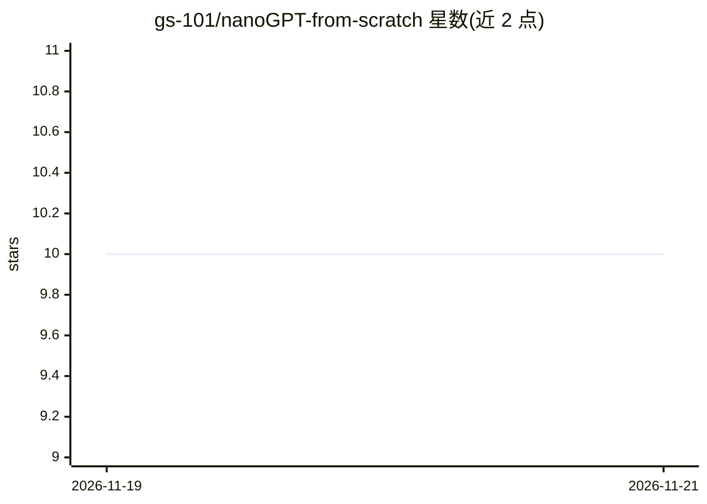

# gs-101/nanoGPT-from-scratch

⭐ 10 · Python · MIT · 推送 2026-01-04 · [GitHub](https://github.com/gs-101/nanoGPT-from-scratch) · [官网](https://codeberg.org/gs-101/nanoGPT-from-scratch) · 个人维护

**Karpathy GPT 讲座的 Org Mode 笔记：逐段记录从零构建 GPT 过程**

跟随 Andrej Karpathy《Let's build GPT: from scratch, in code, spelled out.》讲座整理的 Org Mode 笔记，按视频章节（数据读取、Tokenization、Data Loader、Bigram 基线等）组织，内嵌可执行的 Python 代码块与输出结果，覆盖字符级分词、训练/验证集划分、batch 采样等步骤。数据集使用 tiny_shakespeare，另提及 OpenWebText；依赖 PyTorch。内容为教程性质的讲义记录，面向跟随讲座学习 Transformer 构建过程的读者。

## 筛选速览

| 维度 | 判定 | 备注 |
|---|---|---|
| AI 角色 | `ai-knowledge` | 知识聚合/清单类 |
| 许可风险 | `permissive` | MIT |
| 部署形态 | `None` |  |
| 模型依赖 | — | README 未给出锁定关系 |
| 硬件要求 | — | 无带数字的原话,不猜 |
| 安装摩擦 | `medium` | 含编译或系统依赖之一 |
| 成熟度 | — | 结构信号不足 |

## 能力要点

- 按 YouTube 讲座章节组织的 Org Mode 笔记，附视频时间戳链接
- 内嵌可执行的 Python/Bash 代码块及运行输出结果
- 引用 Attention is All You Need 与 Language Models are Few-Shot Learners 两篇论文
- 数据集使用 tiny_shakespeare，字符级编码

## 适用场景

- 跟随 Karpathy 讲座逐步实现 GPT 时对照笔记执行代码
- 以 Org Mode/Emacs 工作流学习 Transformer 基础
- 查看每一步代码的实际运行输出以理解数据变换

## 场景标签

`教程课程` · 领域:学习与行业

## 证据(README 行号)

> L5: #+title: Let’s Build GPT: From Scratch, in Code, Spelled Out.
> L9: * Summary
> L11: Large Language Model lecture by Andrej Karpathy, going through the process of building a Generatively Pretrained Tr

## 星数曲线

2026-11-19 10 → 2026-11-21 10（+0）

---
*卡片 v1 · prompt 1.4 · 生成 2026-11-19 · 置信度 high · 依据 README sha `2df1e6a561cb` · [字段定义](../../DATASET.md)*
