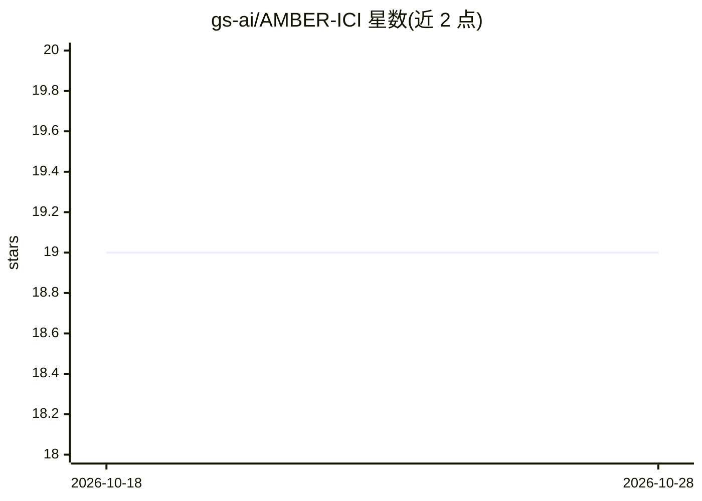

# gs-ai/AMBER-ICI

⭐ 19 · HTML · MIT · 推送 2026-09-01 · [GitHub](https://github.com/gs-ai/AMBER-ICI) · 组织维护

**本地优先的调查分析工作台：基于 Ollama 的案件证据与 agent 链界面**

面向调查/分析场景的浏览器界面，全部推理由本地 Ollama 服务器完成，限定回环端点、无需账号或 API key。提供单模型分析控制台、多模型并行、用户自定义 agent 链（顺序/并行/门控、循环、逐 agent 模型与交接指令）、基于 Ollama 嵌入的语义 Archive 与混合检索、案件边界内的证据登记（SHA-256 身份与溯源）、实体图/时间线/向量库视图，可选 Playwright 网页抓取与 Tesseract OCR、GPU 遥测。核心后端仅用 Python 标准库，无 requirements.txt；Node.js、OCR 等均为可选组件。

## 筛选速览

| 维度 | 判定 | 备注 |
|---|---|---|
| AI 角色 | `ai-native` | 本体是模型或模型工具 |
| 许可风险 | `permissive` | MIT |
| 部署形态 | `library` | 以包/库形式分发 |
| 模型依赖 | local-ok | 支持本地模型 |
| 硬件要求 | — | 无带数字的原话,不猜 |
| 安装摩擦 | `medium` | 含编译或系统依赖之一 |
| 成熟度 | — | 结构信号不足 |

## 能力要点

- 用户自定义 agent 链：逐 agent 本地模型、循环、交接指令与顺序/并行/门控模式
- 案件边界的证据管理：流式 SHA-256 身份、摄取溯源、来源引用，模型输出不自动升格为证据
- 语义 Archive（Ollama 嵌入 + 余弦相似度）与确定性关键词检索融合
- 本地优先：推理限定回环端点，WEB 总开关默认 OFF 时无任何外发请求

## 适用场景

- 调查人员用本地模型对案件文件做多 agent 协作分析
- 把上传文档/OCR 文本归档为案件证据并做语义检索
- 在离线环境下跑实体图、时间线与多模型对比分析

## 场景标签

`多智能体` `语义搜索` · 领域:Agent 开发

## 证据(README 行号)

> L5: AMBER ICI (AMBER Investigative Command Interface) is a local-first browser interface for investigative and analytica
> L20: Ollama inference is restricted by the UI to loopback endpoints (`127.0.0.1`, `localhost`, or `::1`). AMBER does not
> L39: - Streams a conversation with one selected Ollama model

## 星数曲线

2026-10-18 19 → 2026-10-28 19（+0）

---
*卡片 v1 · prompt 1.4 · 生成 2026-10-28 · 置信度 mid · 依据 README sha `d423dba5e977` · [字段定义](../../DATASET.md)*
