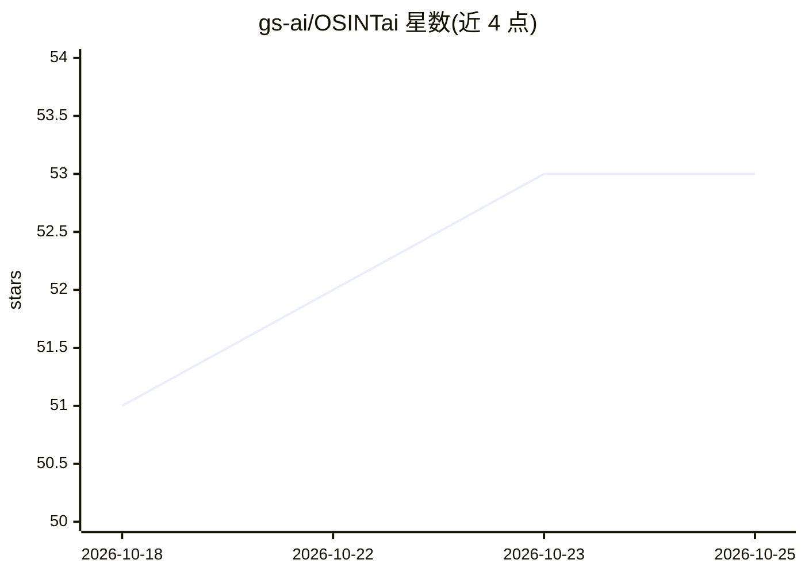

# gs-ai/OSINTai

⭐ 53 · Python · 推送 2026-09-11 · [GitHub](https://github.com/gs-ai/OSINTai) · 组织维护

**本地优先的 OSINT 网络爬虫：AI 辅助证据分析与关联**

面向 OSINT 专业人员、网络安全研究者与数字调查人员的本地优先异步爬虫。功能包括：指标挖掘（邮箱、电话、域名、IP、加密货币地址、社交账号）、加权 Simhash 近重复检测、多因子情报评分、跨源实体关联、时间线与假设生成。AI 部分：通过本地 Ollama 运行 LLM 结构化情报提取（osint-tuned-v3）与 bge-m3 语义嵌入，支持多模型交叉验证；Ollama 为可选，可用 --no-ollama 纯确定性模式运行。输出 JSON/JSONL 报告与 ACE-T 兼容图格式。

## 筛选速览

| 维度 | 判定 | 备注 |
|---|---|---|
| AI 角色 | `ai-enhanced` | 去掉 AI 部分产品仍成立 |
| 许可风险 | `permissive` | — |
| 部署形态 | `library` | 以包/库形式分发 |
| 模型依赖 | local-ok | 支持本地模型 |
| 硬件要求 | — | 无带数字的原话,不猜 |
| 安装摩擦 | `low` | 无编译、无系统依赖或容器化 |
| 成熟度 | — | 结构信号不足 |

## 能力要点

- 异步爬取：可配置并发限制、代理健康轮换、检查点恢复
- Ollama 本地 LLM 情报提取与 bge-m3 嵌入，可选多模型交叉验证保留分歧
- 证据标注的发现、跨源实体关联、时间线与假设，输出确定性可复现
- Hunt 模式按关键词定向发现线索；--analyze-only 离线分析不重新抓取

## 适用场景

- 对授权目标站点做 OSINT 爬取并生成结构化情报报告
- 挖掘邮箱、电话、加密货币地址等指标并做实体关联
- 离线复跑已完成爬取的分析、模型重试与训练数据集导出

## 场景标签

`网页抓取` `网络安全` · 领域:效率与自动化

## 证据(README 行号)

> L12: **OSINTai** is a cutting-edge, AI-enhanced web crawler engineered for **Open Source Intelligence (OSINT)** professi
> L27: - **AI-Powered Content Analysis** using Ollama LLMs for structured intelligence extraction

## 星数曲线

2026-10-18 51 → 2026-10-25 53（+2）

---
*卡片 v1 · prompt 1.4 · 生成 2026-10-24 · 置信度 high · 依据 README sha `0746c1e589f9` · [字段定义](../../DATASET.md)*
