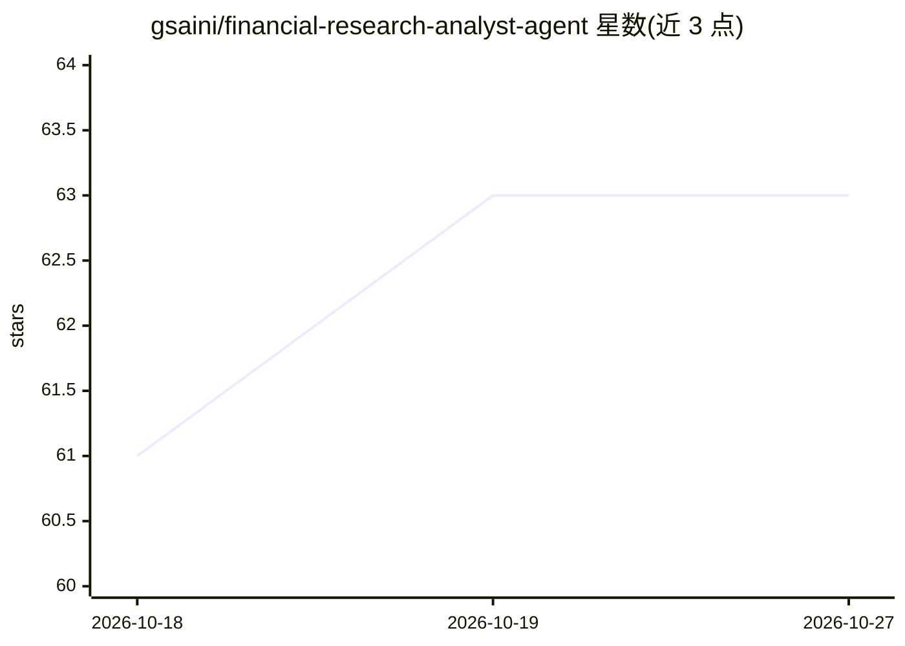

# gsaini/financial-research-analyst-agent

⭐ 63 · Python · NOASSERTION · 推送 2026-05-13 · [GitHub](https://github.com/gsaini/financial-research-analyst-agent) · [官网](https://financial-agents-ai.streamlit.app) · 个人维护

**多智能体股票研究系统：11 个分析 agent 生成投资分析报告**

基于 LangChain/LangGraph 的层级多智能体金融研究系统：Orchestrator 协调数据采集、技术面、基本面、情绪、风险、财报等 11 个专业 agent，配 20+ 分析工具（DCF 估值、Monte Carlo、回测、组合优化、ML 价格预测）与 RAG 管道（摄入 SEC 文件与电话会纪要）。数据层聚合 YFinance/FMP/Alpha Vantage/FRED/Reddit 并自动回退；LLM 默认走 Ollama 本地。提供 Streamlit 13 页仪表盘、FastAPI REST/WebSocket 与 CLI 三种使用方式，可 Docker 部署。

## 筛选速览

| 维度 | 判定 | 备注 |
|---|---|---|
| AI 角色 | `ai-native` | 本体是模型或模型工具 |
| 许可风险 | `none` | NOASSERTION |
| 部署形态 | `self-host` | docker 或自建部署 |
| 模型依赖 | local-ok | 支持本地模型 |
| 硬件要求 | — | 无带数字的原话,不猜 |
| 安装摩擦 | `low` | 无编译、无系统依赖或容器化 |
| 成熟度 | — | 结构信号不足 |

## 能力要点

- 11 个专业 agent + Orchchestrator 的多智能体编排与冲突检测
- RAG 管道摄入 SEC 文件（10-K/10-Q/8-K）与财报电话会纪要
- 20+ 分析工具：DCF、Monte Carlo、回测、组合优化、ML 价格预测
- Streamlit 13 页仪表盘 / REST API / CLI 三种访问方式

## 适用场景

- 自动化生成单只股票的综合分析与 PDF/Excel 报告
- 按投资主题（AI、EV、绿色能源）分组研究股票
- 通过 REST API 把股票分析能力接入自己的系统

## 场景标签

`多智能体` `RAG` `金融量化` · 领域:Agent 开发

## 证据(README 行号)

> L14: **An AI-powered autonomous agent that automates financial data analysis and generates investment insights using Lan
> L24: The **Financial Research Analyst Agent** is an end-to-end AI solution designed to automate financial data analysis 
> L66: |🤖 **Multi-Agent Architecture**|Specialized agents for different analysis tasks|

## 星数曲线

2026-10-18 61 → 2026-10-27 63（+2）

---
*卡片 v1 · prompt 1.4 · 生成 2026-10-24 · 置信度 mid · 依据 README sha `39072682e862` · [字段定义](../../DATASET.md)*
