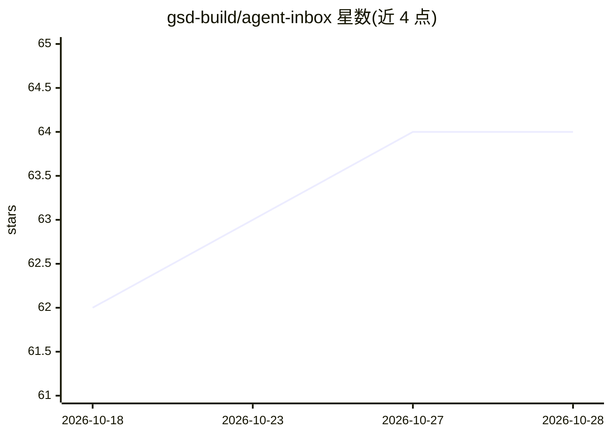

# gsd-build/agent-inbox

⭐ 64 · JavaScript · MIT · 推送 2026-04-10 · [GitHub](https://github.com/gsd-build/agent-inbox) · 组织维护

**给 AI agent 提供一次性邮箱的 MCP 服务器，用于验证邮件与测试**

一个 MCP 服务器，按需创建真实临时邮箱地址，供 AI agent 完成注册、接收确认邮件、提取验证链接并访问链接完成验证。提供 6 个工具：create_inbox、check_inbox、wait_for_email、verify_email、list_inboxes、delete_inbox，支持命名邮箱跨调用引用。无需 API key 与账号，后端用 mail.tm，故障时自动回退到 1secmail；服务器关闭时自动清理邮箱。安装器自动检测并配置 Claude Code、Codex CLI、Cursor、Gemini CLI、Windsurf 等 MCP 客户端。限制：部分服务屏蔽一次性邮箱域名；邮箱仅存于内存，重启即失；仅支持文本与 HTML 正文。

## 筛选速览

| 维度 | 判定 | 备注 |
|---|---|---|
| AI 角色 | `ai-ecosystem` | LLM/agent 周边工具 |
| 许可风险 | `permissive` | MIT |
| 部署形态 | `library` | 以包/库形式分发 |
| 模型依赖 | — | README 未给出锁定关系 |
| 硬件要求 | — | 无带数字的原话,不猜 |
| 安装摩擦 | `low` | 无编译、无系统依赖或容器化 |
| 成熟度 | — | 结构信号不足 |

## 能力要点

- 一次性邮箱创建与验证链接自动提取，verify_email 一次调用完成轮询、提取、访问三步
- 无需 API key 或账号，mail.tm 主用并自动回退 1secmail
- 交互式安装器自动检测并配置多种 AI 编码 agent 的 MCP server
- 服务器退出（SIGINT/SIGTERM）时自动删除邮箱

## 适用场景

- 让 AI agent 自动完成需要邮箱验证的注册流程
- 测试服务的注册与认证（auth）流程
- 在多个 MCP 客户端中给 agent 配置临时邮箱能力

## 场景标签

 · 领域:AI agent 基础设施/MCP 工具

## 证据(README 行号)

> L3: Give any AI agent a disposable email inbox in one tool call.
> L17: An MCP server that creates real, temporary email addresses on demand. Your agent can sign up for services, receive 
> L118: ## Tools

## 星数曲线

2026-10-18 62 → 2026-10-28 64（+2）

---
*卡片 v1 · prompt 1.4 · 生成 2026-10-24 · 置信度 high · 依据 README sha `c017fafe71cc` · [字段定义](../../DATASET.md)*
