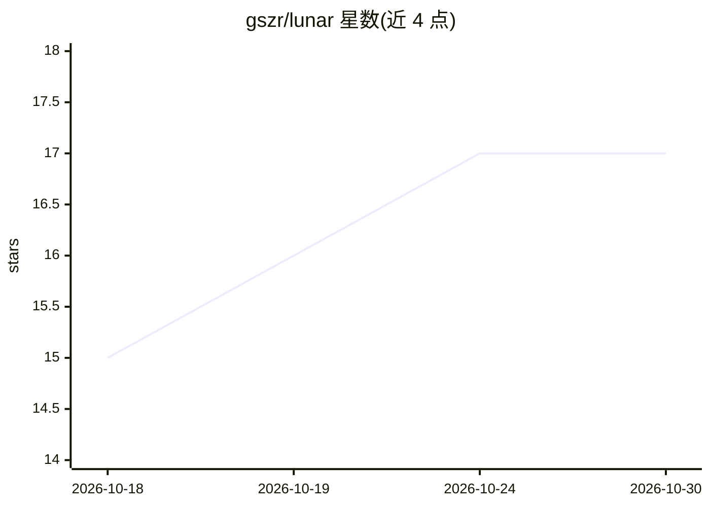

# gszr/lunar

⭐ 17 · Rust · MIT · 推送 2026-10-26 · [GitHub](https://github.com/gszr/lunar) · 个人维护

**Lua 配置的终端编码 harness：连接模型读写执行代码**

用 Rust 实现的终端编码工具：Rust 宿主管理终端、模型传输与四个工具（读、写、编辑、运行命令），Lua 负责模型与提供商配置，不强制计划模式、子代理或审批流程。支持订阅登录（xAI、ChatGPT Plus/Pro、Claude Pro/Max）、API key 及兼容的本地模型服务器；上下文可通过 /context 检查，对话以 JSONL 形式保存为可恢复的 mission。通过 brew 或 cargo 安装。

## 筛选速览

| 维度 | 判定 | 备注 |
|---|---|---|
| AI 角色 | `ai-ecosystem` | LLM/agent 周边工具 |
| 许可风险 | `permissive` | MIT |
| 部署形态 | `library` | 以包/库形式分发 |
| 模型依赖 | local-ok | 支持本地模型 |
| 硬件要求 | — | 无带数字的原话,不猜 |
| 安装摩擦 | `low` | 无编译、无系统依赖或容器化 |
| 成熟度 | — | 结构信号不足 |

## 能力要点

- Rust 宿主 + Lua 配置的极简结构，四个工具无审批提示执行
- /context 检查上下文与 token 使用，手动 /compact 压缩
- 对话保存为本地 JSONL mission，可搜索与恢复
- 支持订阅登录、API key 与兼容本地模型服务器

## 适用场景

- 在终端里让模型读写代码并运行测试
- 跨多仓库工作时只加载仓库地图而非全部代码
- 控制模型读取的规则与上下文，检查 token 去向

## 场景标签

`编码 Agent` · 领域:编码与开发

## 证据(README 行号)

> L15: Lunar is deliberately small: a Rust host owns the terminal, model transport, and four tools, while a Lua guest supp
> L29: - **Use subscriptions, API keys, or local models.** Sign in with xAI, ChatGPT Plus/Pro, or Claude Pro/Max. Bring AP

## 星数曲线

2026-10-18 15 → 2026-10-30 17（+2）

---
*卡片 v1 · prompt 1.4 · 生成 2026-10-29 · 置信度 high · 依据 README sha `82edf2f2f41b` · [字段定义](../../DATASET.md)*
