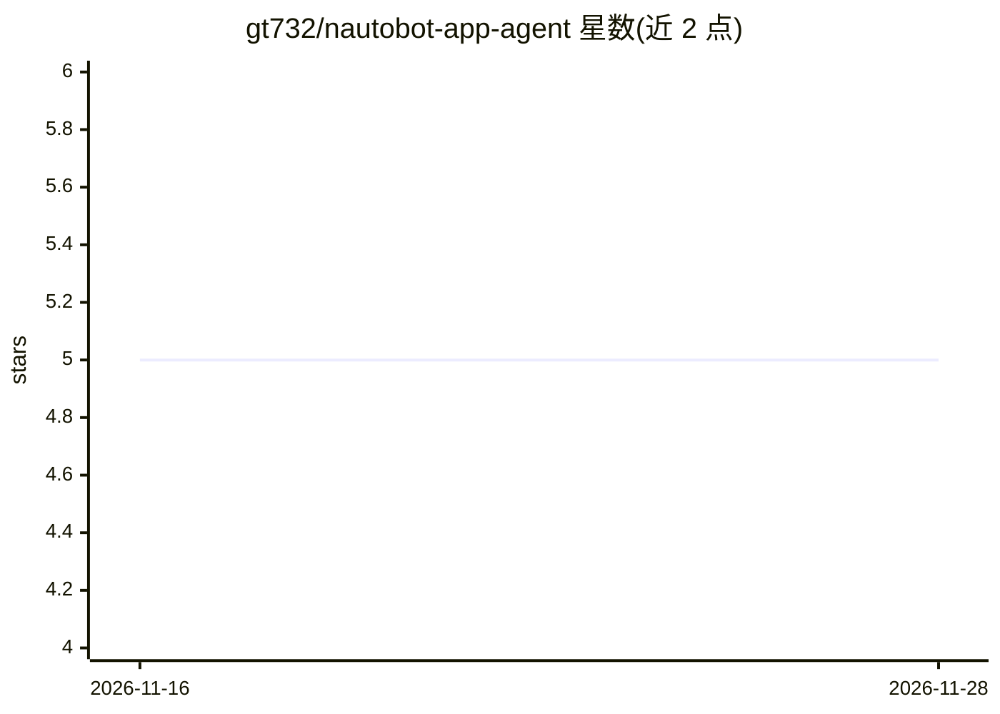

# gt732/nautobot-app-agent

⭐ 5 · Python · MIT · 推送 2026-11-17 · [GitHub](https://github.com/gt732/nautobot-app-agent) · [官网](https://gt732.github.io/nautobot-app-agent/) · 组织维护

**Nautobot 的对话式 AI 助手插件：自然语言查询网络数据**

集成到 Nautobot 的通用对话 agent：通过聊天提问、获取解释与代码示例，内置权限感知且只读的工具连接 Nautobot 资产数据与已安装 App 的源码知识；支持图表与 Mermaid 图渲染、会话保存、执行链路追踪与查看。默认作用域策略仅放行 Nautobot 相关请求，管理员可调整。消息与相关数据会发送至所配置的模型服务商，追踪默认开启且可能包含未脱敏内容。

## 筛选速览

| 维度 | 判定 | 备注 |
|---|---|---|
| AI 角色 | `ai-native` | 本体是模型或模型工具 |
| 许可风险 | `permissive` | MIT |
| 部署形态 | `library` | 以包/库形式分发 |
| 模型依赖 | local-ok | 支持本地模型 |
| 硬件要求 | — | 无带数字的原话,不猜 |
| 安装摩擦 | `low` | 无编译、无系统依赖或容器化 |
| 成熟度 | — | 结构信号不足 |

## 能力要点

- 权限感知、只读的内置工具访问 Nautobot 库存与已装 App 源码
- 多服务商原生集成：OpenAI、Anthropic、Gemini、Ollama、OpenRouter、DeepSeek
- 图表与 Mermaid 图渲染、会话保存、执行追踪
- 可选自定义 skills 与 MCP 集成（独立信任边界）

## 适用场景

- 用自然语言查询 Nautobot 中的网络资产信息
- 在聊天中获得代码示例与概念解释
- 审计 agent 的工具调用与执行链路

## 场景标签

`AI 助手` `聊天机器人` `数据分析` · 领域:效率与自动化

## 证据(README 行号)

> L12: Nautobot Agent is a general-purpose conversational agent integrated into Nautobot. Use it to ask questions, explore
> L27: - Use native integrations for OpenAI, Anthropic, Google Gemini Developer API, Ollama, OpenRouter, and DeepSeek.

## 星数曲线

2026-11-16 5 → 2026-11-28 5（+0）

---
*卡片 v1 · prompt 1.4 · 生成 2026-11-21 · 置信度 high · 依据 README sha `9b5e83eeb930` · [字段定义](../../DATASET.md)*
