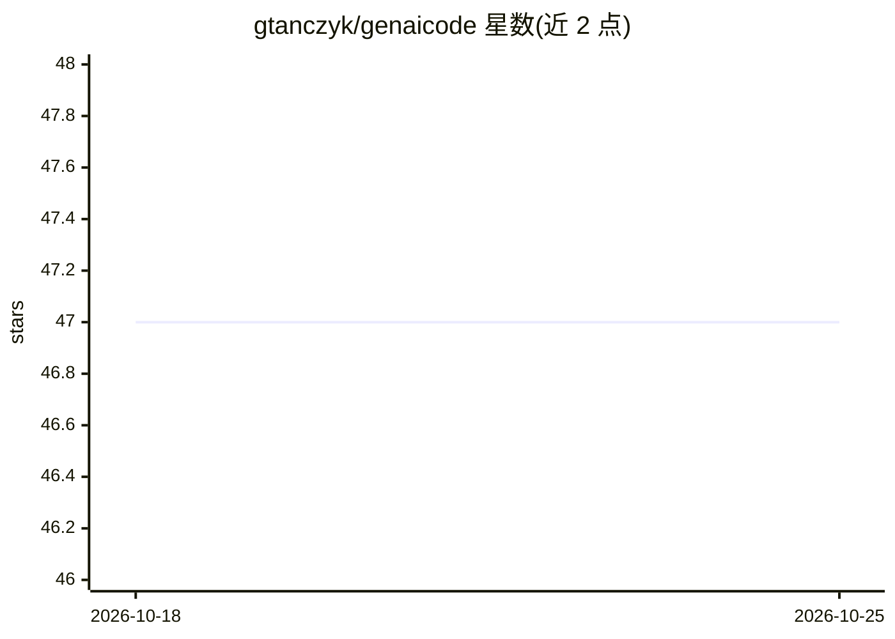

# gtanczyk/genaicode

⭐ 47 · TypeScript · Apache-2.0 · 推送 2026-10-24 · [GitHub](https://github.com/gtanczyk/genaicode) · 个人维护

**TypeScript 后端调用 LLM 的轻量工具包：可移植提示词与多供应商适配器**

面向后端 TypeScript 开发者的 LLM 调用工具包，定位在原生供应商 SDK 与完整 agent 框架之间：提供统一的 PromptItem 提示词表示、面向 OpenAI/Anthropic/Gemini/Vertex AI 的薄适配器、链式请求 API（.text()/.json()/.stream()）与可选中间件、重试助手。核心不执行 shell、不编辑文件；可选的 genaicode/agents 子路径将本机已装的编码 agent CLI（Claude Code、Codex、Cursor 等 9 种）统一为一个任务与事件 API，可从后端代码或 npx genaicode run 命令行编排，另有终端/浏览器聊天界面与 React/Vite 嵌入组件。需 Node.js 20+。

## 筛选速览

| 维度 | 判定 | 备注 |
|---|---|---|
| AI 角色 | `ai-ecosystem` | LLM/agent 周边工具 |
| 许可风险 | `permissive` | Apache-2.0 |
| 部署形态 | `library` | 以包/库形式分发 |
| 模型依赖 | locked-api |  |
| 硬件要求 | — | 无带数字的原话,不猜 |
| 安装摩擦 | `low` | 无编译、无系统依赖或容器化 |
| 成熟度 | — | 结构信号不足 |

## 能力要点

- 统一 PromptItem 提示词表示与多供应商薄适配器
- genaicode/agents 用单一 API 驱动 9 种已装编码 agent CLI（含审批、MCP、steer、验证修复）
- npx genaicode run 命令行无代码运行 agent，--verify 后自动重试修复
- 提供 genaicode/react 聊天组件与 Vite 插件（面板收集页面错误发给 agent）

## 适用场景

- 后端代码在多个 LLM 供应商之间复用同一套提示词与请求逻辑
- 在 CI 或任务脚本中统一编排、对比多种已安装的编码 agent CLI
- 在自己的应用里嵌入带审批与流式输出的 agent 聊天界面

## 场景标签

`Agent 框架` `提示工程` `模型网关` · 领域:Agent 开发

## 证据(README 行号)

> L5: GenAIcode is a small TypeScript toolkit for using LLMs in backend code.
> L7: It sits between raw provider SDKs and full agent frameworks: one prompt representation,
> L84: `genaicode/agents` turns the coding-agent CLIs installed on a machine into one API. Give

## 星数曲线

2026-10-18 47 → 2026-10-25 47（+0）

---
*卡片 v1 · prompt 1.4 · 生成 2026-10-25 · 置信度 high · 依据 README sha `4e6589e1ecb7` · [字段定义](../../DATASET.md)*
