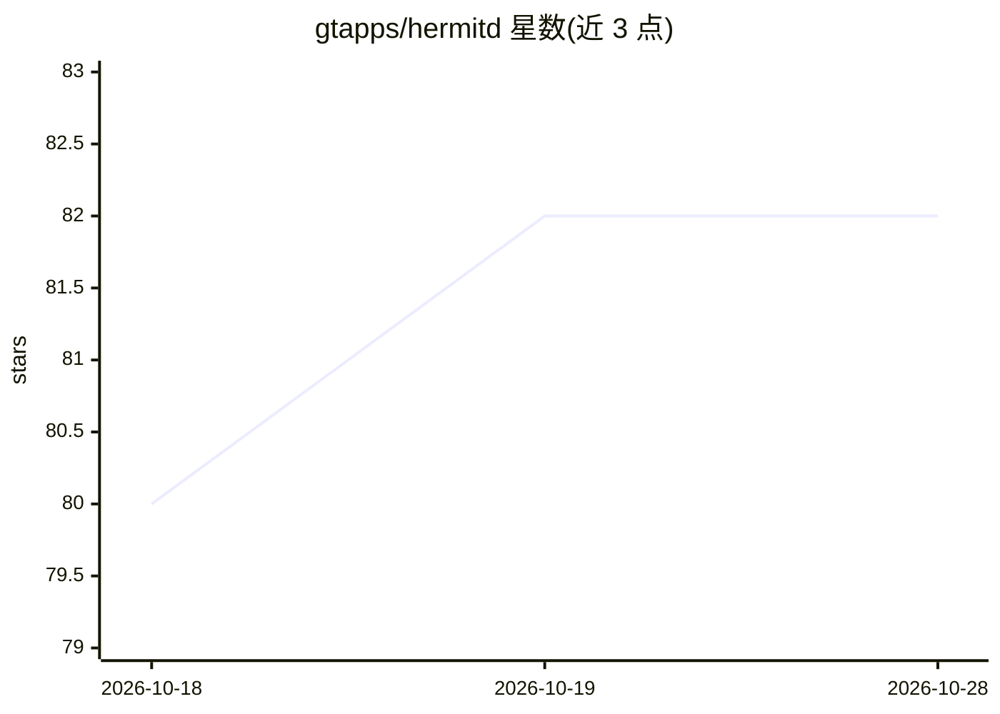

# gtapps/hermitd

⭐ 82 · TypeScript · MIT · 推送 2026-10-27 · [GitHub](https://github.com/gtapps/hermitd) · [官网](https://hermitd.dev) · 组织维护

**本地常驻 Claude Code agent 插件：从聊天渠道启动并托管会话**

hermitd 是官方 Claude Code CLI 的插件（v1.4.20，MIT 许可），在用户自己的机器上运行常驻 agent，可从终端、Claude 应用或 Discord/Telegram/iMessage 等聊天渠道发起并接管会话。核心机制：心跳定期检查分派的责任（维护研究、监控系统、执行例行任务），持久工作状态与归档会话交接跨重启延续进度；看门狗恢复失败会话；心跳检查与跳过的例行任务不消耗模型 token。需 Claude Code 2.1.308+ 与 Bun 1.4+，支持插件安装、bootstrap 脚本与 Docker Compose v2 三种安装方式，tmux 模式需 tmux。使用 Claude 订阅运行，Linux/macOS/Windows via WSL2。

## 筛选速览

| 维度 | 判定 | 备注 |
|---|---|---|
| AI 角色 | `ai-ecosystem` | LLM/agent 周边工具 |
| 许可风险 | `permissive` | MIT |
| 部署形态 | `self-host` | docker 或自建部署 |
| 模型依赖 | locked-api |  |
| 硬件要求 | — | 无带数字的原话,不猜 |
| 安装摩擦 | `low` | 无编译、无系统依赖或容器化 |
| 成熟度 | — | 结构信号不足 |

## 能力要点

- 在自有机器上运行常驻 Claude Code agent，通过 Discord/Telegram/iMessage 等聊天渠道分派与接管工作
- 心跳、例行任务与监控实现主动跟进；安静检查与跳过的例行任务不消耗模型 token
- 持久工作状态与归档会话交接跨压缩与重启延续进度，看门狗恢复失败会话
- 基于经验的学习循环：验证行为变更提案后经用户批准生效

## 适用场景

- 给团队或个人一个随时可从聊天软件指挥的常驻 coding agent
- 让 agent 持续维护研究资料、监控系统并跟进未完成工作
- 在本地网络中让 agent 访问本地数据库、SSH、局域网设备与文件系统

## 场景标签

`编码 Agent` · 领域:编码与开发

## 证据(README 行号)

> L18: **It's Claude Code.** hermitd is a plugin for the official Claude Code CLI, which runs as Anthropic ships it. New C
> L10: Run an always-on Claude Code agent on your own machine, for you or your team. Start sessions from your chat in any 

## 星数曲线

2026-10-18 80 → 2026-10-28 82（+2）

---
*卡片 v1 · prompt 1.4 · 生成 2026-10-24 · 置信度 high · 依据 README sha `4bcf8640e8e6` · [字段定义](../../DATASET.md)*
