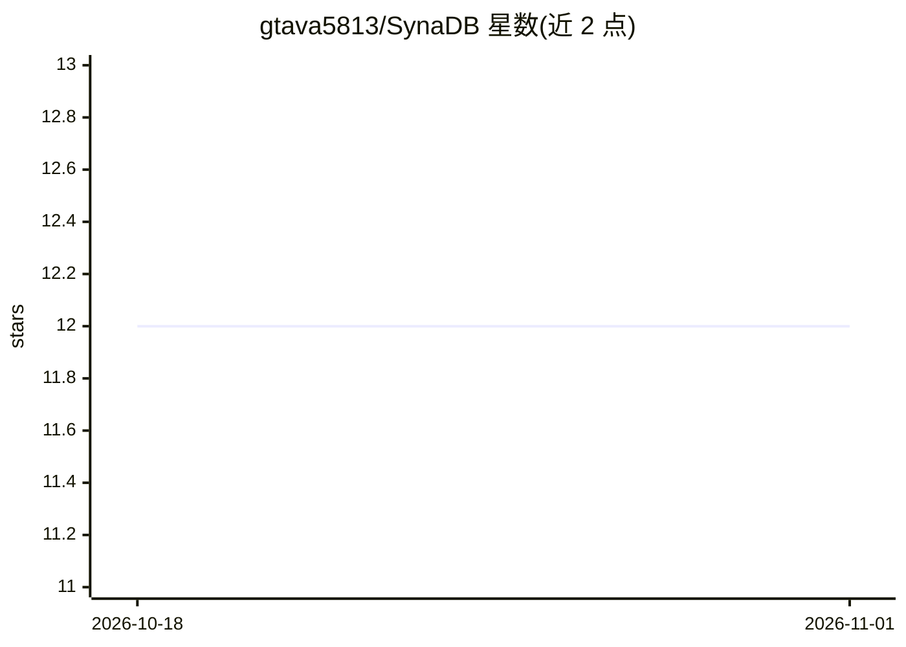

# gtava5813/SynaDB

⭐ 12 · Rust · NOASSERTION · 推送 2026-05-17 · [GitHub](https://github.com/gtava5813/SynaDB) · [官网](https://synadb.ai/) · 个人维护

**面向 AI/ML 的 Rust 嵌入式数据库：向量检索+张量+实验跟踪**

Rust 编写的嵌入式、追加式日志结构、列式映射数据库引擎，支持无 schema 存储与崩溃自动恢复。面向 AI/ML 场景提供：向量存储（HNSW、Gravity Well、Cascade、Mmap、稀疏/混合等多种索引）、TensorEngine 批量张量读取（PyTorch/TensorFlow 集成）、带 SHA-256 校验的模型版本注册、实验跟踪（参数/指标/工件）、特征存储与类 SQL 查询语言 EQL（含时序 join、异常检测、预测）。通过 crates.io、PyPI 安装或源码编译，C-ABI 支持 Python/Node.js/C++ 调用。Cascade 索引与 DAVO 标注为实验性，GPU Direct 与 FAISS 为可选特性。

## 筛选速览

| 维度 | 判定 | 备注 |
|---|---|---|
| AI 角色 | `ai-ecosystem` | LLM/agent 周边工具 |
| 许可风险 | `none` | NOASSERTION |
| 部署形态 | `library` | 以包/库形式分发 |
| 模型依赖 | — | README 未给出锁定关系 |
| 硬件要求 | — | 无带数字的原话,不猜 |
| 安装摩擦 | `high` | 编译与系统依赖俱全 |
| 成熟度 | — | 结构信号不足 |

## 能力要点

- 多种向量索引：HNSW、Gravity Well（O(N) 构建）、Cascade（实验性）、Mmap 高吞吐存储
- TensorEngine 以连续张量读取时序数据，支持 PyTorch/TensorFlow Dataset 集成
- 模型注册（SHA-256 校验、Development→Production→Archived 阶段）与实验跟踪
- EQL 类 SQL 查询语言：时序 join、异常检测、模式匹配、预测、流式窗口

## 适用场景

- RAG 应用中存储 embedding 并做相似度检索（含 BM25/SPLADE 稀疏与混合检索）
- ML 训练中把时序数据按前缀批量读取为张量
- 对模型做版本管理与 SHA-256 完整性校验，跟踪实验参数与指标

## 场景标签

`向量数据库` `MLOps` · 领域:知识与检索

## 证据(README 行号)

> L11: > An AI-native embedded database.
> L19: - **AI/ML optimized** - Extract time-series data as contiguous tensors for PyTorch/TensorFlow
> L29: - **LLM Integrations** - LangChain, LlamaIndex, Haystack support

## 星数曲线

2026-10-18 12 → 2026-11-01 12（+0）

---
*卡片 v1 · prompt 1.4 · 生成 2026-11-01 · 置信度 high · 依据 README sha `037c04f51e64` · [字段定义](../../DATASET.md)*
