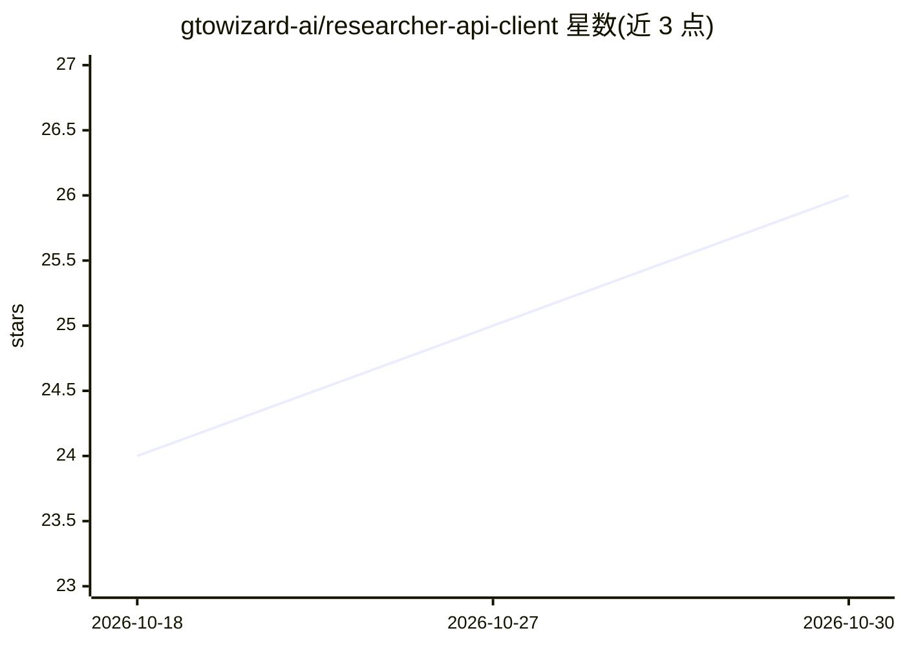

# gtowizard-ai/researcher-api-client

⭐ 26 · Python · 推送 2026-04-09 · [GitHub](https://github.com/gtowizard-ai/researcher-api-client) · [官网](https://researcher.gtowizard.com/docs) · 组织维护

**面向研究者的扑克 AI agent 基准评测 API 客户端**

由 GTO Wizard 维护的 Python 客户端，配合其公开 Research API 在无限制德州扑克中对 AI agent 进行基准评测：agent 与 GTO Wizard AI 对局，采用 AIVAT 低方差评估技术量化表现，结果通过免费网站与实时排行榜公开。仓库内置 allin/check_call/random/fold 四个骨架 agent，自定义 agent 通过实现 PokerAgent 协议接入。需申请 API key（人工审批），API 仅限打牌与查看输赢结果，不开放求解器能力。运行需 Python 3.13+ 与 uv 包管理器。

## 筛选速览

| 维度 | 判定 | 备注 |
|---|---|---|
| AI 角色 | `ai-ecosystem` | LLM/agent 周边工具 |
| 许可风险 | `none` | — |
| 部署形态 | `None` |  |
| 模型依赖 | — | README 未给出锁定关系 |
| 硬件要求 | — | 无带数字的原话,不猜 |
| 安装摩擦 | `low` | 无编译、无系统依赖或容器化 |
| 成熟度 | — | 结构信号不足 |

## 能力要点

- 在 No-Limit Texas Hold'em 环境中基准评测 AI agent
- 使用 AIVAT 无偏低方差评估技术
- 内置 4 个骨架 agent，支持以 PokerAgent 协议自定义 agent
- 评测结果通过公开网站与实时排行榜发布

## 适用场景

- 研究者将自研 LLM/game agent 与 GTO Wizard AI 对战并量化表现
- 复现技术论文中的扑克基准方法论
- 基于骨架 agent 快速搭建自定义策略 agent 进行评测

## 场景标签

`模型评测` · 领域:评测与运维

## 证据(README 行号)

> L2: Despite the growing interest in applying generalist AI agents and LLMs to games, a standardized platform for benchma
> L4: This API enables researchers to test their agents against GTO Wizard AI, a proprietary state-of-the-art poker agent 
> L31: This repository provides skeleton agents to benchmark against GTO Wizard AI:

## 星数曲线

2026-10-18 24 → 2026-10-30 26（+2）

---
*卡片 v1 · prompt 1.4 · 生成 2026-10-27 · 置信度 high · 依据 README sha `bde835d2d877` · [字段定义](../../DATASET.md)*
