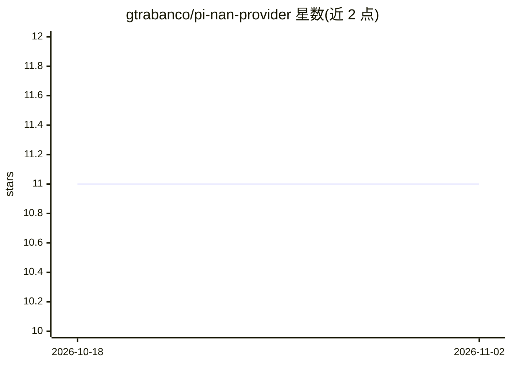

# gtrabanco/pi-nan-provider

⭐ 11 · TypeScript · MIT · 推送 2026-10-26 · [GitHub](https://github.com/gtrabanco/pi-nan-provider) · [官网](https://cloud.nan.builders/r/7GK06FX8) · 个人维护

**为 pi agent 接入 NaN 平台模型与媒体工具的提供者插件**

pi 的扩展包：通过 pi.registerProvider() 以 NaN 的 OpenAI 兼容 API 注册 nan 提供者，采用构建时生成的模型快照与运行时 /models 拉取合并的双层目录，按 API key 层级过滤可用模型，并剔除非聊天端点。附带基于 nan-mcp-server 的社区媒体 MCP 桥（图像生成/编辑、TTS/STT、嵌入），提供 /nan-mcp 管理命令；针对截断流自动重试、上下文溢出错误改写等做了适配处理。要求 pi ≥ 1.3.0，通过 pi install 安装并以 NAN_API_KEY 认证。

## 筛选速览

| 维度 | 判定 | 备注 |
|---|---|---|
| AI 角色 | `ai-ecosystem` | LLM/agent 周边工具 |
| 许可风险 | `permissive` | MIT |
| 部署形态 | `None` |  |
| 模型依赖 | — | README 未给出锁定关系 |
| 硬件要求 | — | 无带数字的原话,不猜 |
| 安装摩擦 | `low` | 无编译、无系统依赖或容器化 |
| 成熟度 | — | 结构信号不足 |

## 能力要点

- 双层模型目录：构建时快照 + 运行时 /models 拉取合并，按 key 层级过滤
- 注册 flux-2-klein、qwen-image-2.1 等 pi 原生图像模型
- 社区媒体 MCP 桥：图像生成/编辑、语音合成/转写、文本嵌入等工具
- 截断流自动重试与上下文溢出 400 错误改写为可压缩信号

## 适用场景

- 在 pi agent 中使用 NaN 平台的聊天与图像模型
- 通过 MCP 工具在会话内生成/编辑图像、合成与转写语音
- 按 API key 层级动态获取可用模型列表

## 场景标签

 · 领域:LLM 基础设施/agent 插件

## 证据(README 行号)

> L9: Registers the `nan` provider via `pi.registerProvider()` using NaN's OpenAI-compatible API (`https://api.nan.builder
> L95: Since pi 0.99.0 ships a built-in MCP client, this package bridges to native MCP (requires **pi >= 1.3.0**, the peer

## 星数曲线

2026-10-18 11 → 2026-11-02 11（+0）

---
*卡片 v1 · prompt 1.4 · 生成 2026-11-02 · 置信度 high · 依据 README sha `d2ec97702f73` · [字段定义](../../DATASET.md)*
