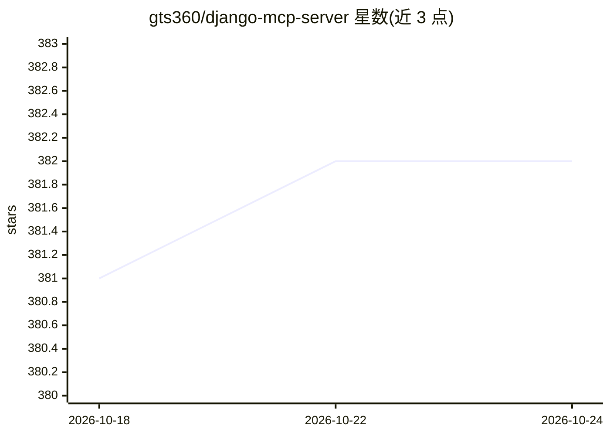

# gts360/django-mcp-server

⭐ 382 · Python · MIT · 推送 2026-03-10 · [GitHub](https://github.com/gts360/django-mcp-server) · 组织维护

**Django 扩展：把 Django 应用暴露为 MCP 工具供 AI Agent 调用**

面向 Django 开发者的 Model Context Protocol 服务器实现：通过声明式 Toolset 子类以约两行代码把 Django 模型暴露为 MCP 查询工具，用注解把 Django Rest Framework 的 Create/Update/Delete/List 视图注册为 MCP 工具并自动生成 schema，也可用 FastMCP 低层注解定义工具与资源。在 WSGI 和 ASGI 上均以 /mcp 端点提供 streamable HTTP 传输，支持 DRF 认证类与 OAuth2、会话/无状态模式、自定义渲染器与多端点。已验证可与 Claude AI 作为远程集成配合。限制：Claude Desktop 仅支持本地 MCP；部分旧 DRF 版本 schema 生成需手动提供；分页等 DRF 内置类在 MCP 工具中默认禁用。

## 筛选速览

| 维度 | 判定 | 备注 |
|---|---|---|
| AI 角色 | `ai-ecosystem` | LLM/agent 周边工具 |
| 许可风险 | `permissive` | MIT |
| 部署形态 | `library` | 以包/库形式分发 |
| 模型依赖 | — | README 未给出锁定关系 |
| 硬件要求 | — | 无带数字的原话,不猜 |
| 安装摩擦 | `low` | 无编译、无系统依赖或容器化 |
| 成熟度 | — | 结构信号不足 |

## 能力要点

- 两行代码将 Django 模型暴露为 MCP 查询工具
- 一条注解把 DRF 视图转换为 MCP 工具并生成 schema
- WSGI 与 ASGI 均可运行，无需改基础设施
- 支持 DRF 认证类、OAuth2、会话/无状态与自定义渲染输出

## 适用场景

- 让 Claude 等 MCP 客户端直接查询我 Django 应用的数据
- 把已有 DRF API 变成 AI Agent 可调用的工具
- 在现有 Django 站点内嵌 MCP 端点供 Agent 框架接入

## 场景标签

 · 领域:AI 应用开发/Web 框架

## 证据(README 行号)

> L9: **Django MCP Server** is an implementation of the **Model Context Protocol (MCP)** extension for Django. This module
> L26: - Expose Django models and logic as **MCP tools**.

## 星数曲线

2026-10-18 381 → 2026-10-24 382（+1）

---
*卡片 v1 · prompt 1.4 · 生成 2026-10-21 · 置信度 high · 依据 README sha `367d9fddad4c` · [字段定义](../../DATASET.md)*
