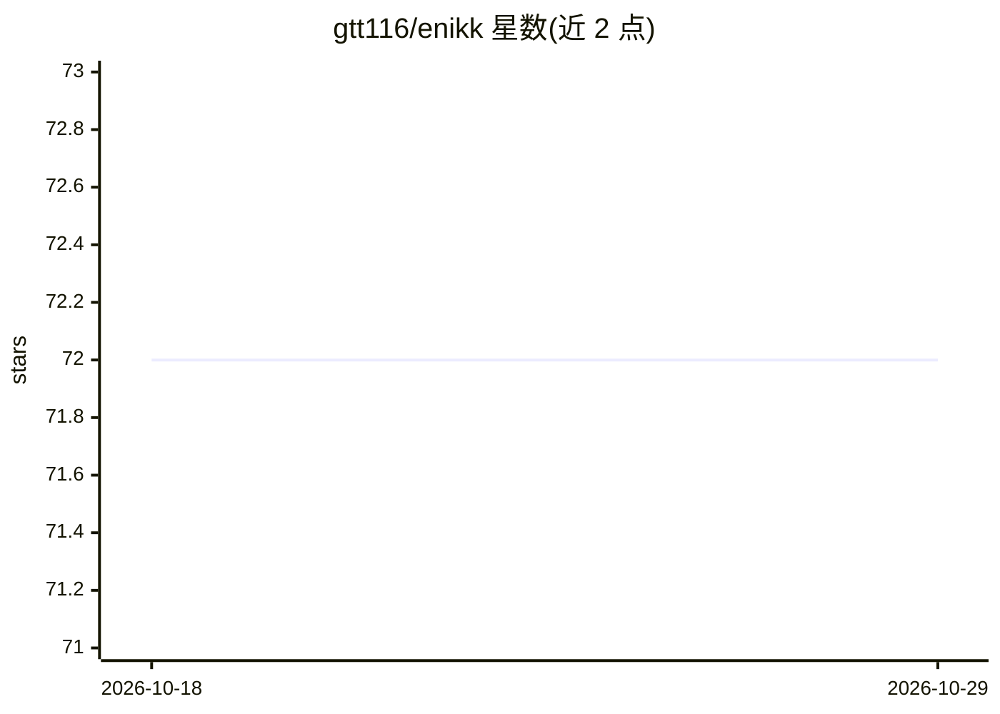

# gtt116/enikk

⭐ 72 · Python · MIT · 推送 2026-10-18 · [GitHub](https://github.com/gtt116/enikk) · [官网](https://enikk.gaott.top/) · 个人维护 · 中文 README

**开源 Computer Use Agent：用任意模型自主操控桌面应用**

运行在 Windows 上的桌面操控 AI agent：通过截屏捕获、YOLO 检测 UI 元素、OCR 读取文字（归一化到 [0,1000] 坐标），由 LLM 决策后执行点击/输入/等待，可操控任意 Windows 桌面应用，内置 NIKKE 与鸣潮支持。任务结束后自动复盘并抽取可复用技能存入持久记忆；通过 Web Dashboard 点选配置，无需写代码；支持 QQ 远程下发任务；数据在本机处理（除 AI API 调用外）。以 GitHub Releases 的可执行包分发，也可从源码构建。声明仅供学习研究用途。

## 筛选速览

| 维度 | 判定 | 备注 |
|---|---|---|
| AI 角色 | `ai-native` | 本体是模型或模型工具 |
| 许可风险 | `permissive` | MIT |
| 部署形态 | `desktop` | 安装包/桌面程序 |
| 模型依赖 | — | README 未给出锁定关系 |
| 硬件要求 | — | 无带数字的原话,不猜 |
| 安装摩擦 | `low` | 无编译、无系统依赖或容器化 |
| 成熟度 | — | 结构信号不足 |

## 能力要点

- 多层感知（YOLO+OCR+VLM）降低视觉模型调用成本
- 任务后自动提取可复用技能到持久记忆
- Web Dashboard 全程可视化配置与观测（截屏/元素/推理/动作）
- 通过 QQ 从手机远程下发任务在本机执行

## 适用场景

- 让 AI agent 自动操作任意 Windows 桌面应用完成任务
- 通过手机 QQ 远程指挥家里电脑执行任务
- 观察和学习 agent 操控桌面的完整决策过程

## 场景标签

`GUI 自动化` · 领域:效率与自动化

## 证据(README 行号)

> L5: **Open-source Computer Use Agent that works for Any App (GUI or CLI) by Any Model (Vision or Text).**
> L11: Enikk is an AI agent that watches your screen, understands what it sees, and operates any desktop application — aut
> L69: 1. **Capture** — Take a screenshot of the target application window

## 星数曲线

2026-10-18 72 → 2026-10-29 72（+0）

---
*卡片 v1 · prompt 1.4 · 生成 2026-10-24 · 置信度 high · 依据 README sha `49710307851e` · [字段定义](../../DATASET.md)*
