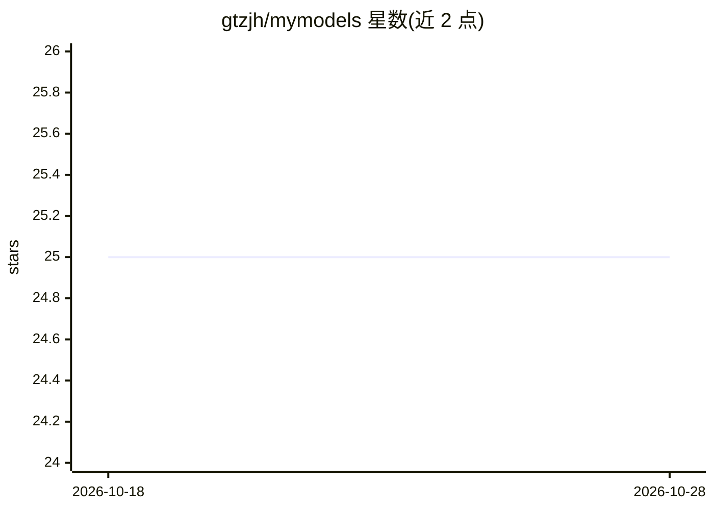

# gtzjh/mymodels

⭐ 25 · Python · MIT · 推送 2025-12-31 · [GitHub](https://github.com/gtzjh/mymodels) · 个人维护 · 中文 README

**面向科研人员的可解释机器学习工作流组装工具**

面向科研人员与学生，提供小型、可解释的机器学习工作流：集成多种编码方法与模型（含 AdaBoost、GBDT 系、K 近邻、线性/逻辑回归、MLP 等主题标签所示模型），配套 Titanic 二分类、多分类与回归的示例 notebook。环境要求 Python 3.10，提供 conda 环境文件与两种 Docker 构建方案（conda 基镜像），容器运行后通过 Jupyter Notebook 交互使用，支持数据与结果目录挂载持久化。Docker 构建配置针对中国网络做了优化。

## 筛选速览

| 维度 | 判定 | 备注 |
|---|---|---|
| AI 角色 | `ai-native` | 本体是模型或模型工具 |
| 许可风险 | `permissive` | MIT |
| 部署形态 | `self-host` | docker 或自建部署 |
| 模型依赖 | — | README 未给出锁定关系 |
| 硬件要求 | — | 无带数字的原话,不猜 |
| 安装摩擦 | `low` | 无编译、无系统依赖或容器化 |
| 成熟度 | — | 结构信号不足 |

## 能力要点

- 集成多种可解释机器学习模型与编码方法的工作流
- 提供二分类/多分类/回归三类示例 notebook（Titanic/Obesity/Housing）
- conda 环境与 Docker 两种部署方式，容器内置 Jupyter 接口
- 支持 Windows/Linux/macOS（Apple Silicon M1 已测试）

## 适用场景

- 科研或课程项目中快速搭建可解释建模流程
- 通过示例 notebook 学习机器学习工作流
- 远程服务器上用 Docker 部署并持久化数据与结果

## 场景标签

`科研工具` `教程课程` · 领域:学习与行业

## 证据(README 行号)

> L9: Project `mymodels`, is targeting on building a **tiny, user-friendly, and efficient** workflow, for the scientific r
> L107: **Try the Titanic demo first**

## 星数曲线

2026-10-18 25 → 2026-10-28 25（+0）

---
*卡片 v1 · prompt 1.4 · 生成 2026-10-27 · 置信度 mid · 依据 README sha `d63fb612e4cb` · [字段定义](../../DATASET.md)*
