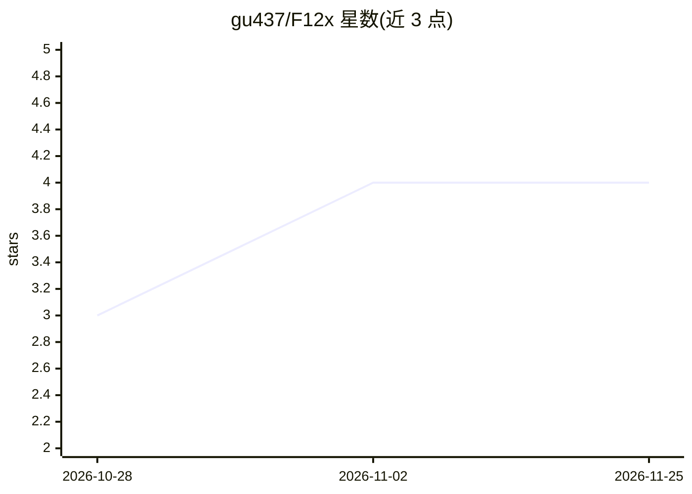

# gu437/F12x

⭐ 4 · JavaScript · AGPL-3.0 · 推送 2026-10-28 · [GitHub](https://github.com/gu437/F12x) · 个人维护 · 中文 README

**给安全测试者在浏览器内做 Web 授权/注入验证的工作台**

Chrome MV3 扩展形式的 Web 安全工作台：通过 chrome.debugger 接入 CDP，提供页面/DOM 侦察、抓包改包（请求阶段拦截）、Repeater 重放、授权矩阵（身份×对象引用差异对比）、Intruder 注入、脚本搜索与 Cookie 编辑等手动工具，配合 Issue、黑板、证据链等本地记录容器。模块化源码无构建步骤，以「加载已解压扩展」方式安装。AI 会话为可选辅助：任务/对话模式、工具调用批准条、上下文压缩与复核审计员，手动功能不依赖 AI 与后端。仅支持 Chromium 系浏览器（Chrome 116+），不支持 Firefox/Safari。

## 筛选速览

| 维度 | 判定 | 备注 |
|---|---|---|
| AI 角色 | `ai-enhanced` | 去掉 AI 部分产品仍成立 |
| 许可风险 | `viral` | AGPL-3.0 |
| 部署形态 | `None` |  |
| 模型依赖 | local-ok | 支持本地模型 |
| 硬件要求 | — | 无带数字的原话,不猜 |
| 安装摩擦 | `medium` | 含编译或系统依赖之一 |
| 成熟度 | — | 结构信号不足 |

## 能力要点

- Repeater 身份切换与授权矩阵（身份×对象引用，差异着色）
- 请求阶段抓包改包：放行改头/伪造响应/丢弃/送 Repeater
- 可选 AI 会话：27 项工具、批准条、信号驱动的对抗性审查与上下文压缩
- 无自有后端无遥测，全部记录仅存本地 chrome.storage.local

## 适用场景

- 对 Web/API 做授权越权与注入点的人工验证
- 在浏览器内抓包改包并留存可核对的证据链
- 接入本地 Ollama 模型做离线辅助侦察

## 场景标签

`网络安全` · 领域:学习与行业

## 证据(README 行号)

> L3: 浏览器原生、人类主导的 **Web 安全工作台**：页面/JS 侦察、抓包改包、身份/授权矩阵、证据链与可选 AI；授权与注入只是其中一条工作流。手动功能不依赖 AI。
> L6: **核心理念：用户是最高驱动者。** 全部手动功能不依赖 AI、不依赖网络与后端；AI 只是辅助工作台。任何 AI 产出都应落到可核对、可留痕的本地记录（黑板 / 审计 / Issue）里，由人最终裁决。

## 星数曲线

2026-10-28 3 → 2026-11-25 4（+1）

---
*卡片 v1 · prompt 1.4 · 生成 2026-11-21 · 置信度 high · 依据 README sha `060b18067465` · [字段定义](../../DATASET.md)*
