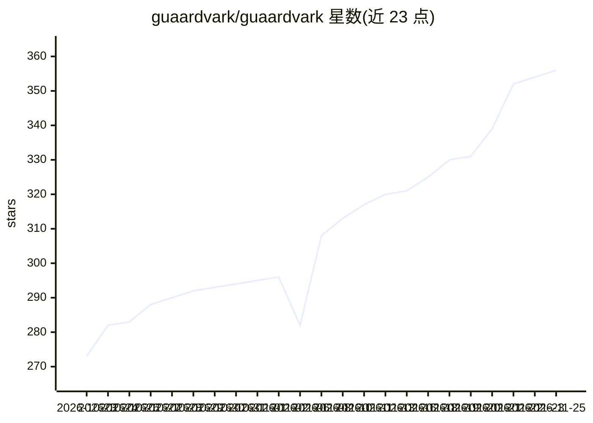

# guaardvark/guaardvark

⭐ 356 · Python · MIT · 推送 2026-11-23 · [GitHub](https://github.com/guaardvark/guaardvark) · [官网](https://guaardvark.com) · 组织维护

**本地 GPU 上自托管的 AI 工作室：对话、agent 与多模态生成**

Guaardvark 是一个自托管 AI 工作室，在用户自己的 GPU 上运行：基于 pgvector 的本地 RAG 问答（混合检索、cross-encoder 重排、来源引用）、控制真实 Ubuntu 桌面的屏幕 agent、各占独立 git worktree 的并行编码 agent 群、LoRA 训练，以及本地视频/图像/音乐/语音生成。内置 MCP 服务器与插件，可被 Claude Code、Cursor 等 agent 驱动；GPU 编排器在同一张卡上分配显存给各任务。默认无遥测，出站路径由 egress.json 声明。提供 Linux 安装脚本、Docker、WSL2、Apple Silicon 与 PyPI CLI。

## 筛选速览

| 维度 | 判定 | 备注 |
|---|---|---|
| AI 角色 | `ai-native` | 本体是模型或模型工具 |
| 许可风险 | `permissive` | MIT |
| 部署形态 | `library` | 以包/库形式分发 |
| 模型依赖 | local-ok | 支持本地模型 |
| 硬件要求 | `gpu-8g` | |
| 安装摩擦 | `medium` | 含编译或系统依赖之一 |
| 成熟度 | — | 结构信号不足 |

## 能力要点

- 本地 RAG：关键词+向量混合检索、重排序、chunk 级来源引用与检索轨迹
- MCP 服务器与插件：Claude Code、Cursor、Gemini CLI 等可运行全部流程
- 屏幕 agent 控制隔离的 Ubuntu 桌面，视觉模型单次推理输出点击坐标并闭环校正
- 三层路由（Reflex/Instinct/Deliberation）按任务复杂度选择 LLM 调用路径

## 适用场景

- 在自己的 GPU 上与本地文档做带引用的问答
- 让 agent 在隔离桌面和浏览器中代为执行任务
- 并行运行多个编码 agent 处理重构/补测试等任务
- 本地生成图像、视频、音乐并训练角色 LoRA

## 场景标签

`RAG` `GUI 自动化` `编码 Agent` `多智能体` · 领域:Agent 开发

## 证据(README 行号)

> L5: **The self-hosted AI studio.** Chat with your own files, hand tasks to agents that use a real desktop and browser, r
> L20: - **It runs on your machine.** Language models, retrieval, agents and every generator run on your own hardware, thr
> L46: - **Chat with your own files.** Local RAG on pgvector: keyword and vector search fused per query, cross-encoder rer

## 星数曲线

2026-10-23 273 → 2026-11-25 356（+83）

---
*卡片 v1 · prompt 1.4 · 生成 2026-11-25 · 置信度 high · 依据 README sha `b74c67378ece` · [字段定义](../../DATASET.md)*
