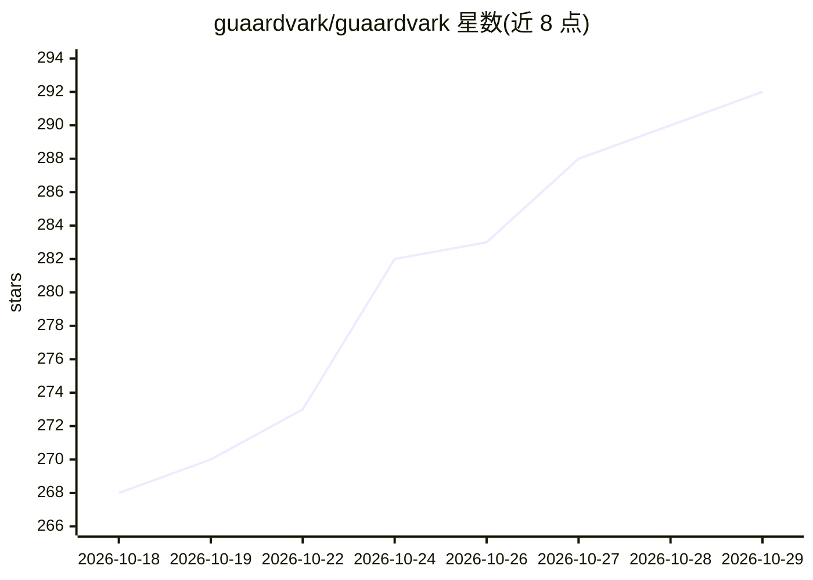

# guaardvark/guaardvark

⭐ 292 · Python · MIT · 推送 2026-10-28 · [GitHub](https://github.com/guaardvark/guaardvark) · [官网](https://guaardvark.com) · 个人维护

**自托管本地 AI 工作室：RAG、桌面/浏览器 agent、生成媒体全跑自有 GPU**

运行在用户自有 GPU 上的本地 AI 工作室：通过 Ollama、ComfyUI 与自带 GPU 服务承载本地模型，无云端 API key 与遥测，出站访问由 egress.json 集中声明。功能含基于 pgvector 的本地 RAG（混合检索、交叉编码器重排、来源引用）、控制真实 Ubuntu 桌面与浏览器的视觉 agent、并行编码 agent 集群、LoRA 训练，以及本地视频/图像/音乐/语音生成。内置 MCP 服务端与 Claude Code 插件，供 Claude Code、Cursor、Codex 等编码 agent 调用。官方路径为 Linux+NVIDIA GPU（视频 16GB 显存起），另提供 Docker、Apple Silicon macOS 与 PyPI CLI；桌面 agent 功能仅限 Linux。

## 筛选速览

| 维度 | 判定 | 备注 |
|---|---|---|
| AI 角色 | `ai-native` | 本体是模型或模型工具 |
| 许可风险 | `permissive` | MIT |
| 部署形态 | `library` | 以包/库形式分发 |
| 模型依赖 | local-ok | 支持本地模型 |
| 硬件要求 | `cpu-ok` | |
| 安装摩擦 | `medium` | 含编译或系统依赖之一 |
| 成熟度 | — | 结构信号不足 |

## 能力要点

- 本地 RAG：pgvector 混合检索+交叉编码器重排+来源引用，Autoresearch 夜间调优检索参数
- 视觉 agent 控制隔离的真实 Ubuntu 桌面与浏览器，闭环点击校准
- 并行编码 agent 集群（git worktree 隔离、依赖序合并），可跑 Claude Code 或本地 Ollama
- 内置 MCP 服务端/客户端与 Claude Code 插件，一键接入多种编码 agent

## 适用场景

- 在自己的 GPU 上搭建无遥测的私有聊天与文档问答知识库
- 让 agent 操作真实桌面和浏览器完成网页任务
- 本地生成视频、图像、音乐、语音并训练角色 LoRA
- 通过 MCP 把本地生成与 RAG 能力接入 Claude Code / Cursor 等编码工具

## 场景标签

`文档问答` `GUI 自动化` `编码 Agent` `图像生成` · 领域:效率与自动化

## 证据(README 行号)

> L5: **The self-hosted AI studio.** Chat with your own files, hand tasks to agents that use a real desktop and browser, r
> L20: - **It runs on your machine.** Language models, retrieval, agents and every generator run on your own hardware, thr
> L46: - **Chat with your own files.** Local RAG on pgvector: keyword and vector search fused per query, cross-encoder rer

## 星数曲线

2026-10-18 268 → 2026-10-29 292（+24）

---
*卡片 v1 · prompt 1.4 · 生成 2026-10-22 · 置信度 high · 依据 README sha `7e00cafd9059` · [字段定义](../../DATASET.md)*
