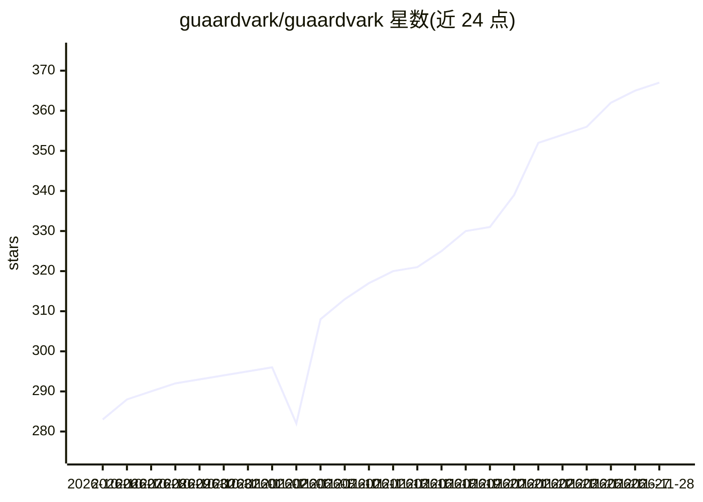

# guaardvark/guaardvark

⭐ 367 · Python · MIT · 推送 2026-11-27 · [GitHub](https://github.com/guaardvark/guaardvark) · [官网](https://guaardvark.com) · 个人维护

**自托管 AI 工作室：本地 GPU 上跑 RAG、代理与生成**

在自有 GPU 上运行的自托管 AI 工作室：本地 RAG 问答（pgvector 混合检索、重排、引用出处）、使用真实 Ubuntu 桌面与浏览器的屏幕代理、git worktree 隔离的并行编码代理群、LoRA 训练，以及视频/图像/音乐/语音生成。内置 MCP 服务器供 Claude Code、Cursor 等代理驱动全部流程，出口连接集中在 egress.json 文件管理。提供 Linux 一键安装脚本、Docker、WSL2、Apple Silicon 与 PyPI CLI 多种途径。

## 筛选速览

| 维度 | 判定 | 备注 |
|---|---|---|
| AI 角色 | `ai-native` | 本体是模型或模型工具 |
| 许可风险 | `permissive` | MIT |
| 部署形态 | `library` | 以包/库形式分发 |
| 模型依赖 | local-ok | 支持本地模型 |
| 硬件要求 | `gpu-8g` | |
| 安装摩擦 | `medium` | 含编译或系统依赖之一 |
| 成熟度 | — | 结构信号不足 |

## 能力要点

- 本地 RAG：pgvector 混合检索、cross-encoder 重排、来源引用与检索轨迹
- 屏幕代理控制隔离的 Ubuntu 桌面，视觉模型闭环定位点击
- 13 个本地视频模型与多款图像模型，单张 16 GB 显卡可运行
- 内置 MCP 服务器与 16 个代理技能，可被外部编码代理驱动

## 适用场景

- 在本地对自己上传的文档做带引用的知识问答
- 让代理在真实桌面与浏览器里自动完成操作任务
- 在自己的 GPU 上训练角色 LoRA 并生成图像视频
- 多个编码代理并行处理重构任务后按依赖合并

## 场景标签

`多智能体` `GUI 自动化` `编码 Agent` `图像生成` · 领域:Agent 开发

## 证据(README 行号)

> L5: **The self-hosted AI studio.** Chat with your own files, hand tasks to agents that use a real desktop and browser, r
> L20: - **It runs on your machine.** Language models, retrieval, agents and every generator run on your own hardware, thr
> L50: - **Chat with your own files.** Local RAG on pgvector: keyword and vector search fused per query, cross-encoder rer

## 星数曲线

2026-10-26 283 → 2026-11-28 367（+84）

---
*卡片 v1 · prompt 1.4 · 生成 2026-11-28 · 置信度 high · 依据 README sha `cff5a700edce` · [字段定义](../../DATASET.md)*
