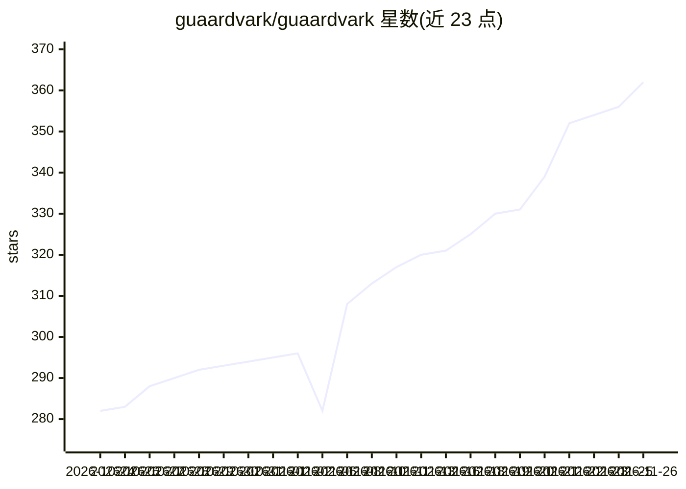

# guaardvark/guaardvark

⭐ 362 · Python · MIT · 推送 2026-11-25 · [GitHub](https://github.com/guaardvark/guaardvark) · [官网](https://guaardvark.com) · 个人维护

**自托管 AI 工作室：本地 GPU 上跑聊天/RAG、桌面代理与多模态生成**

以 MIT 许可发布的自托管 AI 工作室，全部推理在用户自有 GPU 上运行，通过 Ollama、ComfyUI 及其自带 GPU 服务调度。功能包括基于 pgvector 的本地 RAG（混合检索、交叉编码器重排、来源引用）、控制真实 Ubuntu 桌面的屏幕代理、并行编码代理群、LoRA 训练、视频/图像/音乐/语音本地生成，以及内置 MCP 服务器供 Claude Code、Cursor 等代理接入。默认无遥测，出站路径集中在 egress.json 声明。默认安装面向 NVIDIA GPU 的 Linux，另支持 WSL2、Docker、Apple Silicon 与 PyPI CLI。

## 筛选速览

| 维度 | 判定 | 备注 |
|---|---|---|
| AI 角色 | `ai-native` | 本体是模型或模型工具 |
| 许可风险 | `permissive` | MIT |
| 部署形态 | `library` | 以包/库形式分发 |
| 模型依赖 | local-ok | 支持本地模型 |
| 硬件要求 | `gpu-8g` | |
| 安装摩擦 | `medium` | 含编译或系统依赖之一 |
| 成熟度 | — | 结构信号不足 |

## 能力要点

- 本地 RAG：pgvector 混合检索、交叉编码器重排、带来源引用
- 屏幕代理在隔离 Ubuntu 桌面（Xvfb/XFCE）上通过视觉模型操作
- 内置 MCP 服务器与插件，可被 Claude Code、Cursor 等代理驱动
- 13 个本地视频模型与 LoRA 训练，GPU 编排器调度显存

## 适用场景

- 在自有 GPU 上与本地文档进行带引用的问答
- 让代理操作隔离桌面完成浏览与页面任务
- 本地生成视频、图像、音乐并训练角色 LoRA

## 场景标签

`RAG` `GUI 自动化` `编码 Agent` `多智能体` · 领域:Agent 开发

## 证据(README 行号)

> L5: **The self-hosted AI studio.** Chat with your own files, hand tasks to agents that use a real desktop and browser, r
> L20: - **It runs on your machine.** Language models, retrieval, agents and every generator run on your own hardware, thr
> L22: - **Your coding agent can drive it.** A built-in MCP server, sixteen agent skills and plugins for Claude Code, Grok

## 星数曲线

2026-10-24 282 → 2026-11-26 362（+80）

---
*卡片 v1 · prompt 1.4 · 生成 2026-11-26 · 置信度 high · 依据 README sha `19a14eef80de` · [字段定义](../../DATASET.md)*
