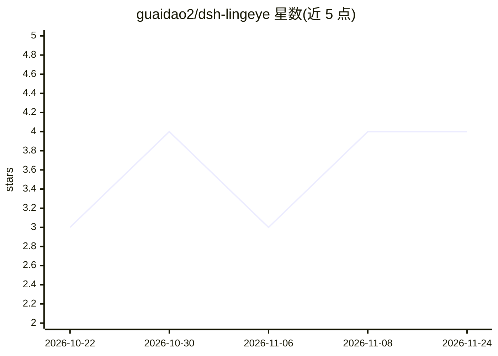

# guaidao2/dsh-lingeye

⭐ 4 · JavaScript · MIT · 推送 2026-11-09 · [GitHub](https://github.com/guaidao2/dsh-lingeye) · 个人维护 · 中文 README

**DeepSeek Harness 的授权渗透测试 agent 模式插件**

作为 DeepSeek Harness（DSH）的会话模式插件运行：进入后指挥官 agent 以 DAG-MDP 信念状态的探索图管理目标、意图、事实与漏洞，事实带 basis 与置信度，否定结论保留；执行与复测派发给八类角色子 agent，记录落在共享存储域并由 Web 页签实时展示。提供依赖门控排序（ly_next）、证据 sha256 内容寻址、独立复测记录与 report.md/findings.json 等导出。需 DSH 0.2.2-rc.1~0.3.0 与 Node.js >= 22.5，经 dsh plugin 命令安装。

## 筛选速览

| 维度 | 判定 | 备注 |
|---|---|---|
| AI 角色 | `ai-native` | 本体是模型或模型工具 |
| 许可风险 | `permissive` | MIT |
| 部署形态 | `desktop` | 安装包/桌面程序 |
| 模型依赖 | locked-api |  |
| 硬件要求 | — | 无带数字的原话,不猜 |
| 安装摩擦 | `low` | 无编译、无系统依赖或容器化 |
| 成熟度 | — | 结构信号不足 |

## 能力要点

- 探索图以 DAG-MDP 信念状态记录事实与置信度，失败落 negative 事实
- 八类角色子 agent 预设（执行/复测/情报/枚举/威胁建模等），编排由 DSH 提供
- 证据记录观测信道并按 sha256 内容寻址，复测结论 reproduced/fixed/inconclusive
- 内置 Windows ACL 沙箱社区修复，Git Bash 环境增强默认关闭

## 适用场景

- 对获得授权的目标执行可复核的渗透测试流程
- 将侦察、利用、复测与报告连成一条证据链交付
- 通过操控中心跨会话汇总项目漏洞与资产

## 场景标签

`网络安全` · 领域:学习与行业

## 证据(README 行号)

> L5: 灵眼不是普通功能插件，而是一个 **agent 模式**：新建会话时像「标准模式」「创造模式」一样选择「灵眼渗透测试模式」。进入后，指挥官 agent 维护目标、探索链路、资产、漏洞、证据与复测；执行与复测交给子 agent，所有记
> L13: - **探索图是 DAG-MDP 的信念状态**：goal → intent → fact → 新 intent → finding；事实带 basis（observed / inferred / assumed / negati

## 星数曲线

2026-10-22 3 → 2026-11-24 4（+1）

---
*卡片 v1 · prompt 1.4 · 生成 2026-11-21 · 置信度 mid · 依据 README sha `499a894ce916` · [字段定义](../../DATASET.md)*
