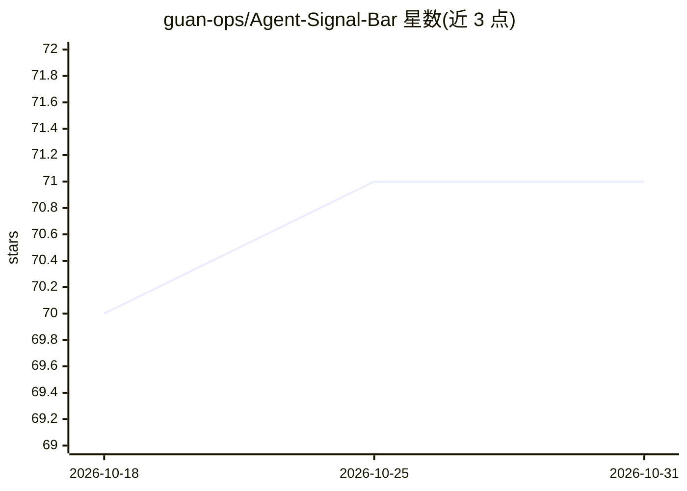

# guan-ops/Agent-Signal-Bar

⭐ 71 · Swift · Apache-2.0 · 推送 2026-10-05 · [GitHub](https://github.com/guan-ops/Agent-Signal-Bar) · [官网](https://agentsignalbar.app) · 个人维护 · 中文 README

**macOS 状态栏/桌面悬浮 AI Agent 信号灯，监控 Codex 与 Claude Code**

面向 macOS 14+ 开发者的本地优先菜单栏应用：以红黄绿交通灯形式在菜单栏与可拖拽桌面悬浮窗中显示 AI agent 的 idle/working/permission/blocked 等状态。自动从本地 Codex 会话日志检测 Desktop、CLI/TUI、VS Code、Xcode、IDEA 内的活动；Claude Code、脚本与自定义 agent 通过本地 hooks、内置 CLI 或 JSON 事件上报。另提供 Codex 配额、token 与成本估算视图，支持多账号保存与多币种换算；不依赖后端账号，DMG 安装，ad-hoc 签名未公证。

## 筛选速览

| 维度 | 判定 | 备注 |
|---|---|---|
| AI 角色 | `ai-enhanced` | 去掉 AI 部分产品仍成立 |
| 许可风险 | `permissive` | Apache-2.0 |
| 部署形态 | `desktop` | 安装包/桌面程序 |
| 模型依赖 | — | README 未给出锁定关系 |
| 硬件要求 | — | 无带数字的原话,不猜 |
| 安装摩擦 | `low` | 无编译、无系统依赖或容器化 |
| 成熟度 | — | 结构信号不足 |

## 能力要点

- 免 hooks 自动检测 Codex 本地会话日志（Desktop/CLI/VS Code/Xcode/IDEA）
- Claude Code hooks、通用 JSON 适配器与 agent-signal CLI 扩展点
- 菜单栏与桌面悬浮信号灯同步，红黄状态优先于普通工作事件
- Codex 配额/token/成本估算，17 种货币换算，本地优先无后端账号

## 适用场景

- 不切回终端即可知道 AI agent 在思考、等待批准还是已完成
- 用信号灯监控本地脚本与自定义 agent 的运行状态
- 查看 Codex 配额、token 消耗与成本估算

## 场景标签

 · 领域:开发者工具/桌面应用

## 证据(README 行号)

> L23: Agent Signal Bar turns local AI-agent activity into a simple traffic-light language in your macOS menu bar and an o
> L27: - **Stay in flow.** See whether an agent is thinking, working, or done without reopening its terminal or editor.
> L90: - **Local extension points** through Codex hooks, Claude Code hooks, a generic JSON adapter, and the `agent-signal`

## 星数曲线

2026-10-18 70 → 2026-10-31 71（+1）

---
*卡片 v1 · prompt 1.4 · 生成 2026-10-24 · 置信度 high · 依据 README sha `2314c4896e88` · [字段定义](../../DATASET.md)*
