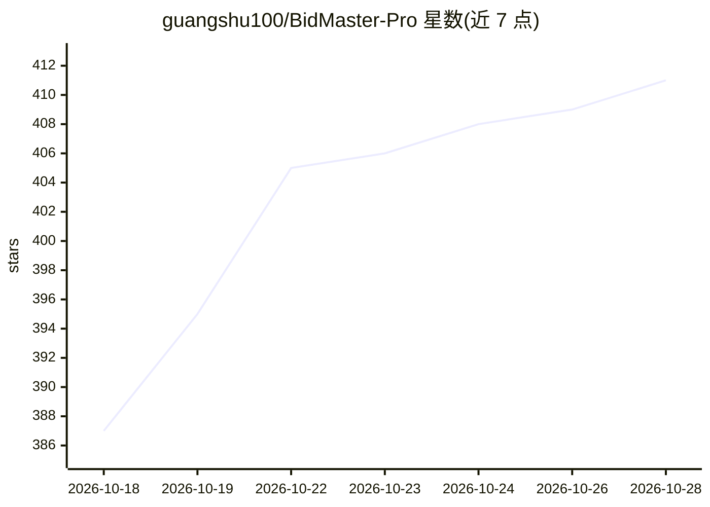

# guangshu100/BidMaster-Pro

⭐ 411 · Python · AGPL-3.0 · 推送 2026-09-03 · [GitHub](https://github.com/guangshu100/BidMaster-Pro) · 组织维护 · 中文 README

**面向招投标人员的全流程 AI Agent：标书生成·检查·排版·商机监控**

基于 LLM、RAG 与 Skill 引擎的招投标工作流平台，覆盖招标解读、投标书生成、投标检查（21 项合规规则）、文档排版导出（docx/doc/PDF）四个阶段流水线，另有咨询问答、商机监控、知识库管理与 RBAC 多用户协作。通过 LiteLLM 支持 DeepSeek、硅基流动、OpenAI、通义千问、Ollama 等多模型切换，接入 MinerU OCR 抽取扫描件。后端 FastAPI + PostgreSQL/Redis/MinIO，前端 React + Electron 桌面客户端，提供 Docker 与本地源码两种部署方式。

## 筛选速览

| 维度 | 判定 | 备注 |
|---|---|---|
| AI 角色 | `ai-native` | 本体是模型或模型工具 |
| 许可风险 | `viral` | AGPL-3.0 |
| 部署形态 | `self-host` | docker 或自建部署 |
| 模型依赖 | local-ok | 支持本地模型 |
| 硬件要求 | — | 无带数字的原话,不猜 |
| 安装摩擦 | `low` | 无编译、无系统依赖或容器化 |
| 成熟度 | — | 结构信号不足 |

## 能力要点

- 4 阶段流水线：招标解读/投标生成/投标检查/文档排版
- 21 项合规检查规则与多 Agent 协同工作流
- 多 LLM 供应商切换（DeepSeek/OpenAI/通义/Ollama 等）+ RAG 知识库（语义重排）
- MinerU OCR 扫描件抽取与商机监控、热点聚合

## 适用场景

- 上传招标文件自动解读要点并生成投标书
- 对已完成标书做合规性与一致性检查
- 集中管理企业资料与历史标书并检索复用
- 定时抓取招投标公告，按关键词匹配商机

## 场景标签

`工作流自动化` `RAG` `多智能体` `AI 写作` · 领域:Agent 开发

## 证据(README 行号)

> L17: BidMaster Pro 是基于 AI Agent 架构的全流程智能招投标平台。通过 LLM（大语言模型）、RAG（检索增强生成）和 Skill Engine（技能引擎）三大核心引擎，实现从**招标文件解读**、**投标书自动生
> L44: #### 1. 招标解读 (Interpret)

## 星数曲线

2026-10-18 387 → 2026-10-28 411（+24）

---
*卡片 v1 · prompt 1.4 · 生成 2026-10-21 · 置信度 high · 依据 README sha `71430007ba28` · [字段定义](../../DATASET.md)*
