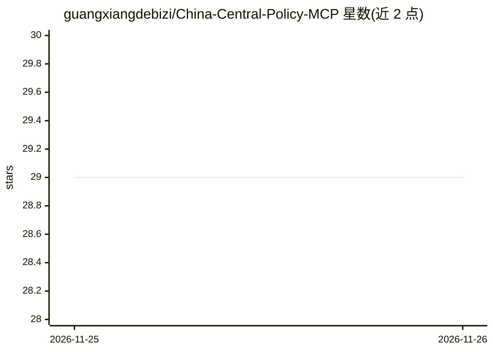

# guangxiangdebizi/China-Central-Policy-MCP

⭐ 29 · TypeScript · Apache-2.0 · 推送 2026-11-23 · [GitHub](https://github.com/guangxiangdebizi/China-Central-Policy-MCP) · 个人维护 · 中文 README

**面向 gov.cn 的中央政策检索与解析 MCP 服务器**

MCP 服务器，连接中国政府网官方栏目与检索接口，提供政策目录搜索（search_policies）、正文读取与段落定位（get_policy_fulltext）、相关解读查找与简报生成（policy_brief 等）共 6 个工具，输出带原文段号、引用卡与 outputSchema 的 Markdown+JSON 结构化数据。支持 stdio 与 Streamable HTTP 两种传输，内置请求限流、缓存、续查游标与 ok/partial/error 状态语义。服务端不调用大模型、不需要 Token 或模型密钥，仅代抓 www.gov.cn 域。

## 筛选速览

| 维度 | 判定 | 备注 |
|---|---|---|
| AI 角色 | `ai-ecosystem` | LLM/agent 周边工具 |
| 许可风险 | `permissive` | Apache-2.0 |
| 部署形态 | `None` |  |
| 模型依赖 | — | README 未给出锁定关系 |
| 硬件要求 | — | 无带数字的原话,不猜 |
| 安装摩擦 | `low` | 无编译、无系统依赖或容器化 |
| 成熟度 | — | 结构信号不足 |

## 能力要点

- 提供政策检索、全文读取、解读链接与简报生成 6 个 MCP 工具
- 返回带段号、引用卡与 outputSchema 的结构化 Markdown+JSON 数据
- 支持 stdio 与 Streamable HTTP 两种传输方式，含续查游标与限流缓存机制
- 不申请密钥、不调用大模型，仅抓取 www.gov.cn 域内容

## 适用场景

- 按主题、文号或日期检索国务院及部委政策并读取全文
- 定位政策原文中特定条款段落，生成可引用材料
- 整理指定主题近一段时间的政策简报与原文对照材料
- 接入 MCP 客户端为 LLM 会话提供政策数据工具

## 场景标签

`网页抓取` `科研工具` · 领域:效率与自动化

## 证据(README 行号)

> L1: # 中国中央政策 MCP
> L19: 默认使用 stdio。启动后等待 MCP 客户端输入，不向 stdout 写日志。
> L160: 产物返回 `path`、`downloadUrl`（未配置时 null）、`bytes`、`sha256`。HTTP 提供 `GET /files/<随机UUID>/policy-brief.md` 和 `.json`；平台应在

## 星数曲线

2026-11-25 29 → 2026-11-26 29（+0）

---
*卡片 v1 · prompt 1.4 · 生成 2026-11-24 · 置信度 high · 依据 README sha `f347ca430922` · [字段定义](../../DATASET.md)*
