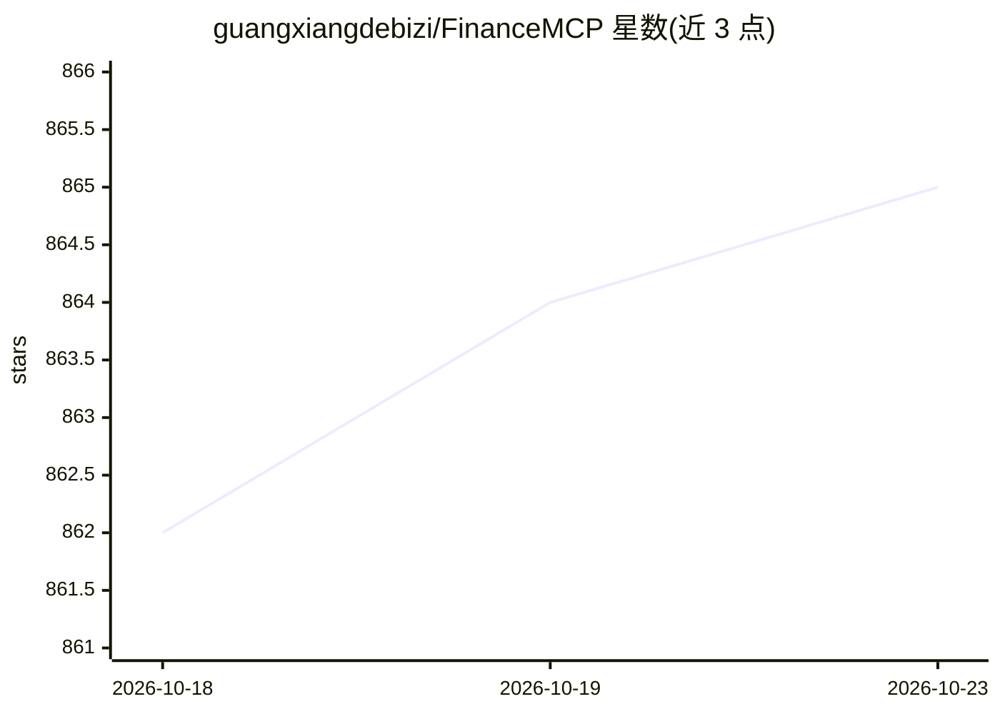

# guangxiangdebizi/FinanceMCP

⭐ 865 · TypeScript · MIT · 推送 2026-10-19 · [GitHub](https://github.com/guangxiangdebizi/FinanceMCP) · 个人维护 · 中文 README

**为 AI Agent 提供多市场金融数据的 MCP 服务器**

基于 Node.js、Express 与 MCP SDK 构建的金融数据 MCP Server，通过 19 个 MCP 工具为 Claude Desktop、Cursor、Codex 等 MCP 客户端及 AI Agent 提供股票、基金、债券、期货、宏观、财经新闻与加密资产数据。数据源覆盖 Tushare、Qveris、Binance 公开 API、Twingly 与百度新闻，按凭证与优先级自动路由并在失败时降级。支持本地 stdio 与 Streamable HTTP 两种接入方式；公网托管 Endpoint 当前暂停，可自行部署（提供 Dockerfile）。

## 筛选速览

| 维度 | 判定 | 备注 |
|---|---|---|
| AI 角色 | `ai-ecosystem` | LLM/agent 周边工具 |
| 许可风险 | `permissive` | MIT |
| 部署形态 | `self-host` | docker 或自建部署 |
| 模型依赖 | — | README 未给出锁定关系 |
| 硬件要求 | — | 无带数字的原话,不猜 |
| 安装摩擦 | `low` | 无编译、无系统依赖或容器化 |
| 成熟度 | — | 结构信号不足 |

## 能力要点

- 19 个 MCP 工具覆盖 A 股/港股/美股/基金/债券/期货/宏观/加密资产等多市场
- Tushare/Qveris/Binance/Twingly/百度新闻多源智能路由与自动降级，返回标注实际来源
- 支持本地 stdio 与远程 Streamable HTTP 双传输模式
- 内置 MACD/RSI/KDJ/BOLL/MA 技术指标计算

## 适用场景

- 在 Claude Desktop、Cursor 等 MCP 客户端中查询股票、基金、宏观数据与财经新闻
- 为投研或金融分析类 AI Agent 提供统一的金融数据后端
- 自行部署远程 MCP 服务供团队 AI 应用调用

## 场景标签

`金融量化` · 领域:学习与行业

## 证据(README 行号)

> L7:  为 AI Agent 提供统一、可路由、可追溯的多市场金融数据
> L44: 在 FinNote 的整体架构中，FinanceMCP 作为核心的 **金融数据与 MCP 工具服务层**，基于 Node.js、Express 与 Model Context Protocol（MCP）SDK 构建。目前通过 1
> L52: 因此，FinanceMCP 不仅可以作为独立的金融数据 MCP Server 接入 Claude、Cursor、Codex 等 MCP Client 或 AI Agent，也可以作为 FinNote 等上层 AI 应用的金融数据基

## 星数曲线

2026-10-18 862 → 2026-10-23 865（+3）

---
*卡片 v1 · prompt 1.4 · 生成 2026-10-21 · 置信度 high · 依据 README sha `f3a1e01ba2ce` · [字段定义](../../DATASET.md)*
