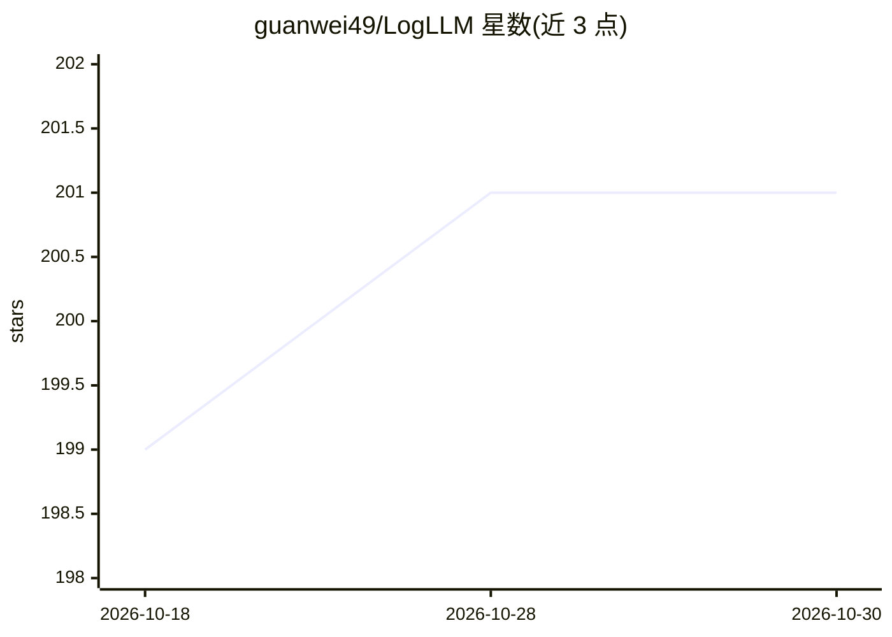

# guanwei49/LogLLM

⭐ 201 · Python · MIT · 推送 2025-12-09 · [GitHub](https://github.com/guanwei49/LogLLM) · 个人维护

**用 LLM 做系统日志异常检测的研究代码（论文官方实现）**

论文 LogLLM: Log-based Anomaly Detection Using Large Language Models 的官方实现：基于 Meta-Llama-3-8B 与 bert-base-uncased，通过监督微调在 HDFS、BGL、Liberty、Thunderbird 四个日志数据集上做异常检测，README 给出四数据集的统计信息与多方法（DeepLog、LogBERT、LogRobust 等）对比的 Precision/Recall/F1 结果表。复现流程包括 conda/pip 环境搭建（Python 3.8、CUDA 12.1）、下载模型与数据集、滑动窗口/会话窗口数据准备、train.py 微调（可跳过直接用提供的微调模型）与 eval.py 评估，另提供 BGL 和 Liberty 的测试文件。

## 筛选速览

| 维度 | 判定 | 备注 |
|---|---|---|
| AI 角色 | `ai-native` | 本体是模型或模型工具 |
| 许可风险 | `permissive` | MIT |
| 部署形态 | `library` | 以包/库形式分发 |
| 模型依赖 | — | README 未给出锁定关系 |
| 硬件要求 | — | 无带数字的原话,不猜 |
| 安装摩擦 | `medium` | 含编译或系统依赖之一 |
| 成熟度 | — | 结构信号不足 |

## 能力要点

- 基于 Meta-Llama-3-8B + BERT 微调的日志异常检测
- 覆盖 HDFS/BGL/Liberty/Thunderbird 四个数据集
- 提供微调模型（ft_model）与 BGL/Liberty 测试文件
- 与 DeepLog、LogBERT、LogRobust 等方法给出对比结果表

## 适用场景

- 复现论文中的日志异常检测实验结果
- 在自有系统日志上训练/评估 LLM 异常检测模型
- 对比不同日志异常检测方法的基准数据

## 场景标签

`网络安全` `微调` · 领域:学习与行业

## 证据(README 行号)

> L3: Official Implementation of "LogLLM: Log-based Anomaly Detection Using Large Language Models"
> L35: |LogLLM|&#10008;|0.994|**1.000**|**0.997**|0.861|0.979|**0.916**|**0.992**|0.926|**0.958**|**0.966**|0.966|**0.966*

## 星数曲线

2026-10-18 199 → 2026-10-30 201（+2）

---
*卡片 v1 · prompt 1.4 · 生成 2026-10-22 · 置信度 mid · 依据 README sha `1aca4de954d3` · [字段定义](../../DATASET.md)*
