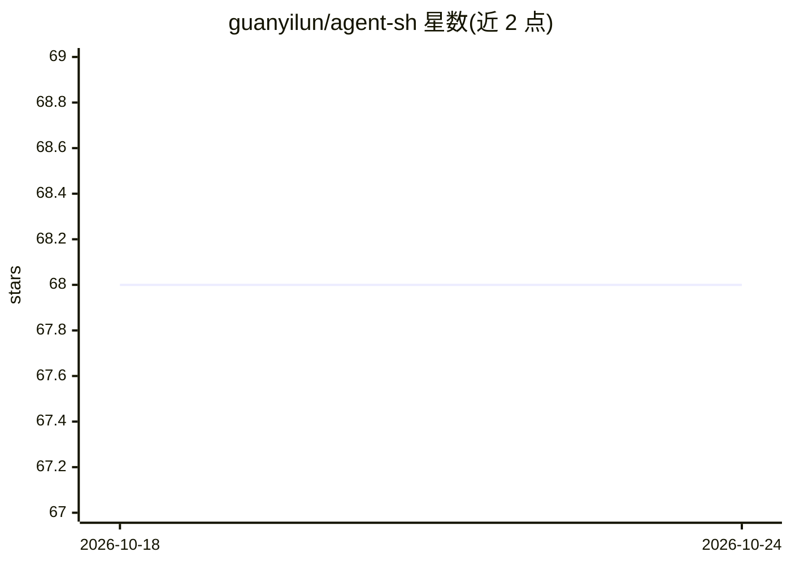

# guanyilun/agent-sh

⭐ 68 · TypeScript · MIT · 推送 2026-10-21 · [GitHub](https://github.com/guanyilun/agent-sh) · [官网](https://agent-sh.dev) · 个人维护

**可组合 agent 运行时：任意前端搭配任意 agent 后端**

以纯内核（类型化事件总线、处理器注册表、扩展加载器）为核心的组合式 agent 运行时：内置基于 node-pty 的 shell 前端，行首输入 `>` 即可唤起 agent，agent 自动感知 cwd、上一条命令及其输出。后端可切换：内置轻量 agent ash（兼容任意 OpenAI 兼容 API），或通过桥接承载 pi、claude-code、opencode。同一运行时可驱动 ashi（TUI 聊天式）与 asHub（桌面 GUI）等前端。需 Node.js 22+，交互 shell 层仅支持 bash/zsh/fish，Windows 需 WSL。

## 筛选速览

| 维度 | 判定 | 备注 |
|---|---|---|
| AI 角色 | `ai-ecosystem` | LLM/agent 周边工具 |
| 许可风险 | `permissive` | MIT |
| 部署形态 | `desktop` | 安装包/桌面程序 |
| 模型依赖 | local-ok | 支持本地模型 |
| 硬件要求 | — | 无带数字的原话,不猜 |
| 安装摩擦 | `low` | 无编译、无系统依赖或容器化 |
| 成熟度 | — | 结构信号不足 |

## 能力要点

- 行首 `>` 唤起 agent，共享 shell 上下文（cwd、命令历史与输出）
- 后端可换：内置 ash 或桥接 pi / claude-code / opencode
- 前端本身是扩展，同一运行时驱动 shell、ashi TUI 与 asHub GUI
- 扩展系统：工具、内容变换、slash 命令、主题、渲染层均可插拔

## 适用场景

- 在熟悉的 shell 里一行切换地调用 coding agent
- 已有 pi / claude-code / opencode 使用习惯，保留其工具集换用此终端前端
- 把 agent 运行时嵌入自己的应用或自建前端
- 通过 OpenRouter / Ollama 等本地或托管模型运行轻量 agent ash

## 场景标签

`编码 Agent` `Agent 框架` · 领域:Agent 开发

## 证据(README 行号)

> L6: A composable agent runtime — pair any frontend with any agent backend, over one shared extension layer.
> L173: At agent-sh's center is a pure kernel — a typed event bus, a named-handler registry, and an extension loader — tha
> L175: The frontend and the agent backend are both just components on the bus, so you **mix and match** them freely — wir

## 星数曲线

2026-10-18 68 → 2026-10-24 68（+0）

---
*卡片 v1 · prompt 1.4 · 生成 2026-10-24 · 置信度 high · 依据 README sha `d4e4eaf5da4d` · [字段定义](../../DATASET.md)*
