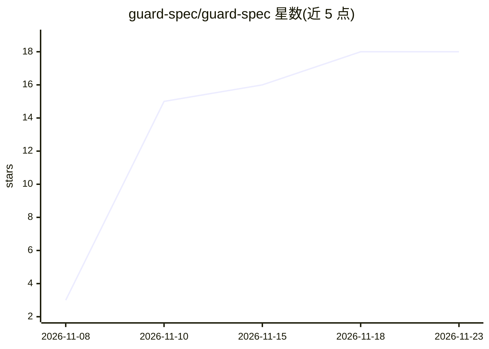

# guard-spec/guard-spec

⭐ 18 · Go · Apache-2.0 · 推送 2026-11-22 · [GitHub](https://github.com/guard-spec/guard-spec) · [官网](https://guardspec.io) · 组织维护

**自托管提示注入防火墙：LLM 应用前的 OpenAI 兼容网关**

用 Go 编写的自托管网关，部署在应用与 LLM API（OpenAI 兼容接口或 Anthropic Messages API）之间，检测并拦截提示注入：检查用户消息、工具结果、检索文档与 MCP 工具描述，再对模型回答做外链/个人数据/金丝雀泄露检查。检测层为 L1 规则+自带 ONNX 分类器+相似度三层融合，覆盖英语与越南语。附带多租户控制平面、CEL 策略、SSO/SCIM、告警与管理 UI，以 Docker Compose/Helm 部署。当前 v0.10.0 pre-1.0，API 与数据库结构可能变动；非内容审核系统；无 Node 时管理 UI 仅显示占位页。

## 筛选速览

| 维度 | 判定 | 备注 |
|---|---|---|
| AI 角色 | `ai-ecosystem` | LLM/agent 周边工具 |
| 许可风险 | `permissive` | Apache-2.0 |
| 部署形态 | `self-host` | docker 或自建部署 |
| 模型依赖 | local-ok | 支持本地模型 |
| 硬件要求 | — | 无带数字的原话,不猜 |
| 安装摩擦 | `low` | 无编译、无系统依赖或容器化 |
| 成熟度 | `idea` | |

## 能力要点

- 三层检测融合：规则（含越南语变形）、自有 ONNX 分类器、攻击样本相似度
- 输出侧守卫：外泄链接、个人数据（含越南语证件号）、金丝雀泄露，含流式场景
- OpenAI 兼容与 Anthropic Messages API 代理，改 base URL 即接入，可路由多上游
- 多租户控制平面：组织/项目策略（编译为 CEL）、SSO/SAML/SCIM、审计与多渠道告警

## 适用场景

- 自托管 LLM 应用拦截提示注入，不把提示发给第三方审核 API
- 面向越南语用户的聊天/RAG/Agent 系统做注入防护
- 平台团队为多个内部团队或客户提供带审计与策略隔离的统一网关

## 场景标签

`模型网关` `网络安全` · 领域:Agent 开发

## 证据(README 行号)

> L25: Guard Spec is a self-hosted gateway that sits between your application and an
> L26: LLM API (OpenAI-compatible, or Anthropic's Messages API) and blocks prompt
> L122: Guard Spec runs next to your application, inside your network. Your app keeps
> L123: its OpenAI SDK and points `base_url` at the gateway; every LLM call, with the

## 星数曲线

2026-11-08 3 → 2026-11-23 18（+15）

---
*卡片 v1 · prompt 1.4 · 生成 2026-11-18 · 置信度 high · 依据 README sha `c39ac6d93220` · [字段定义](../../DATASET.md)*
