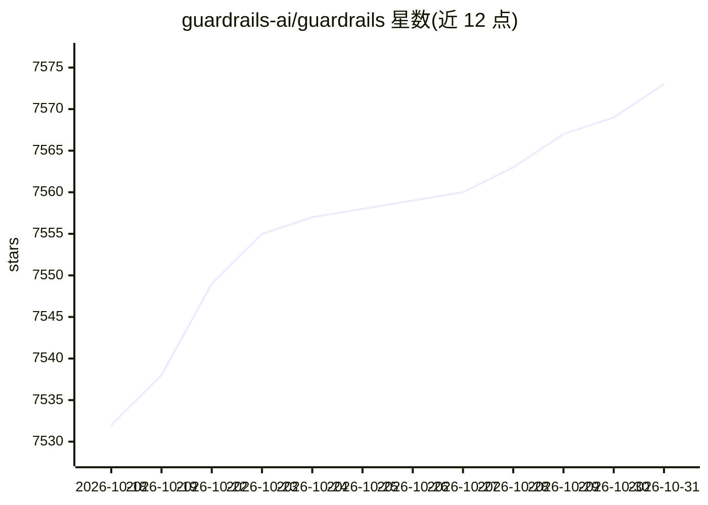

# guardrails-ai/guardrails

⭐ 7,573 · Python · Apache-2.0 · 推送 2026-10-29 · [GitHub](https://github.com/guardrails-ai/guardrails) · [官网](https://www.guardrailsai.com/docs) · 组织维护

**LLM 应用的输入/输出校验防护框架**

Python 框架，为 LLM 应用提供两类功能：一是从 Guardrails Hub 安装 validator 并组合成 Input/Output Guards，拦截 LLM 输入输出以检测、量化和缓解特定风险（如毒性语言、竞品提及、正则校验）；二是从 LLM 生成符合 Pydantic 模型的结构化数据（通过 function calling 或 prompt 优化）。支持以 Flask 独立服务运行（guardrails start，REST API），生产部署建议 Docker + Gunicorn。2026 年 7 月公告：validator 迁移至标准 PyPI 包，托管远程推理服务将停用（计划截止 2026-08-25）。

## 筛选速览

| 维度 | 判定 | 备注 |
|---|---|---|
| AI 角色 | `ai-ecosystem` | LLM/agent 周边工具 |
| 许可风险 | `permissive` | Apache-2.0 |
| 部署形态 | `library` | 以包/库形式分发 |
| 模型依赖 | — | README 未给出锁定关系 |
| 硬件要求 | — | 无带数字的原话,不猜 |
| 安装摩擦 | `low` | 无编译、无系统依赖或容器化 |
| 成熟度 | — | 结构信号不足 |

## 能力要点

- 从 Guardrails Hub 按 pip 安装 validator 并组合成 Guard
- Input/Output Guards 拦截并校验 LLM 输入输出
- 基于 Pydantic 模型生成结构化数据（function calling / prompt 优化）
- 可作独立服务运行（Flask，REST API），生产建议 Docker+Gunicorn

## 适用场景

- 给 LLM 应用的输入输出加校验防护（毒性、竞品、格式等）
- 让 LLM 按指定结构输出数据
- 以 REST 服务形式在应用中部署 Guards

## 场景标签

 · 领域:LLM 基础设施/应用防护

## 证据(README 行号)

> L24: Guardrails is a Python framework that helps build reliable AI applications by performing two key functions:
> L25: 1. Guardrails runs Input/Output Guards in your application that detect, quantify and mitigate the presence of speci

## 星数曲线

2026-10-18 7,532 → 2026-10-31 7,573（+41）

---
*卡片 v1 · prompt 1.4 · 生成 2026-10-20 · 置信度 high · 依据 README sha `40ce0777e179` · [字段定义](../../DATASET.md)*
