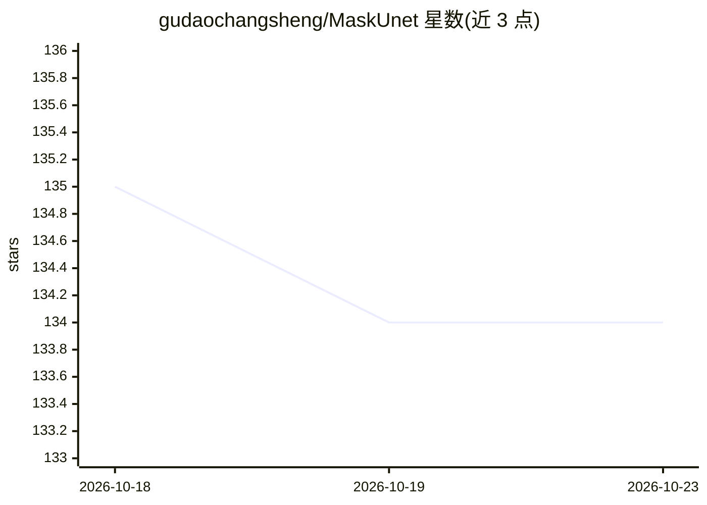

# gudaochangsheng/MaskUnet

⭐ 134 · Python · 推送 2026-05-19 · [GitHub](https://github.com/gudaochangsheng/MaskUnet) · [官网](https://gudaochangsheng.github.io/MaskUnet-Page/) · 组织维护 · 中文 README

**CVPR 2025 论文官方实现：掩码 U-Net 参数提升扩散生成质量**

论文《Not All Parameters Matter: Masking Diffusion Models for Enhancing Generation Ability》的官方 PyTorch 实现。方法是在扩散模型去噪过程中，基于时间步与样本依赖的有效参数，动态掩码部分 U-Net 参数以提升生成质量。提供两种设置：基于训练的掩码优化与免训练的推理时掩码优化，均构建于 Stable Diffusion 1.5 之上。安装通过 conda environment.yaml 完成，训练与推理以 shell 脚本运行，数据集使用 fantasyfish/laion-art。在 COCO 及下游任务上报告零样本生成结果。

## 筛选速览

| 维度 | 判定 | 备注 |
|---|---|---|
| AI 角色 | `ai-native` | 本体是模型或模型工具 |
| 许可风险 | `none` | — |
| 部署形态 | `None` |  |
| 模型依赖 | — | README 未给出锁定关系 |
| 硬件要求 | — | 无带数字的原话,不猜 |
| 安装摩擦 | `low` | 无编译、无系统依赖或容器化 |
| 成熟度 | — | 结构信号不足 |

## 能力要点

- 基于时间步与样本依赖的 U-Net 参数动态掩码方法
- 提供训练版与免训练版两种设置
- 构建于 Stable Diffusion 1.5，附加参数量可忽略（论文声明）
- 提供训练与推理的 shell 脚本入口

## 适用场景

- 复现 CVPR 2025 论文的扩散模型掩码实验
- 在 SD 1.5 基础上研究/应用参数掩码提升生成质量
- 作为扩散模型参数有效性研究的代码基础

## 场景标签

`图像生成` · 领域:内容生成

## 证据(README 行号)

> L3: # 🚀 MaskUnet: Not All Parameters Matter for Enhancing Diffusion Generation
> L21: - We propose **MaskUnet**, a simple yet effective method that leverages **timestep- and sample-dependent effective 
> L45: - **Training-based MaskUnet**

## 星数曲线

2026-10-18 135 → 2026-10-23 134（-1）

---
*卡片 v1 · prompt 1.4 · 生成 2026-10-22 · 置信度 high · 依据 README sha `94b7ab762432` · [字段定义](../../DATASET.md)*
