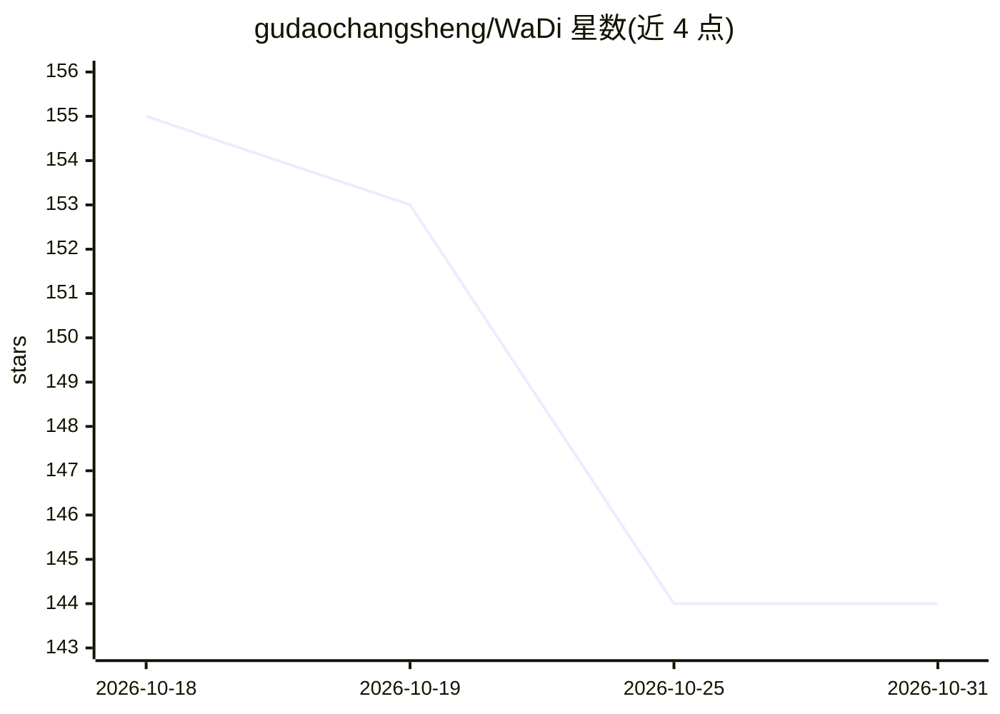

# gudaochangsheng/WaDi

⭐ 144 · Python · 推送 2026-05-26 · [GitHub](https://github.com/gudaochangsheng/WaDi) · [官网](https://gudaochangsheng.github.io/WaDi-Page/) · 组织维护 · 中文 README

**给科研/开发者：一步图像生成的扩散蒸馏训练框架**

CVPR 2026 论文的官方 PyTorch 实现：提出 LoRaD 低秩旋转适配器建模蒸馏中的权重方向变化，基于 VSD 构建 WaDi 一步蒸馏框架，把多步扩散模型（SD1.5/SD2.1/PixArt）蒸馏为一步生成器。在 COCO 2014/2017 上报告 FID 结果，可训练参数约为原 U-Net/DiT 的 10%，蒸馏模型支持可控生成、relation inversion 与高分辨率合成。提供 Hugging Face 在线 Demo、模型权重（HF/ModelScope）与本地训练/推理脚本，本地运行需 git clone 并安装依赖，推理用 GPU 训练环境。

## 筛选速览

| 维度 | 判定 | 备注 |
|---|---|---|
| AI 角色 | `ai-native` | 本体是模型或模型工具 |
| 许可风险 | `none` | — |
| 部署形态 | `None` |  |
| 模型依赖 | — | README 未给出锁定关系 |
| 硬件要求 | — | 无带数字的原话,不猜 |
| 安装摩擦 | `low` | 无编译、无系统依赖或容器化 |
| 成熟度 | — | 结构信号不足 |

## 能力要点

- LoRaD 低秩旋转适配器建模权重方向变化
- 基于 VSD 的一步蒸馏框架，~10% 可训练参数
- 覆盖 SD1.5/SD2.1（U-Net）与 PixArt（DiT）
- 提供浏览器在线 Demo 与 HF/ModelScope 权重下载

## 适用场景

- 把多步扩散模型蒸馏成一步生成器以加速推理
- 复现 CVPR 2026 论文的一步蒸馏训练与推理
- 在可控生成、高分辨率合成等下游任务中使用蒸馏模型

## 场景标签

`图像生成` `科研工具` `微调` · 领域:内容生成

## 证据(README 行号)

> L124: - We build **WaDi**, a weight direction-aware one-step distillation framework based on **VSD**.
> L150: Motivated by this finding, we propose **LoRaD** (**Lo**w-rank **Ra**tation of weight **D**irection), a lightweight
> L152: WaDi achieves **state-of-the-art FID** on **COCO 2014** and **COCO 2017** while using only **~10%** of the trainab

## 星数曲线

2026-10-18 155 → 2026-10-31 144（-11）

---
*卡片 v1 · prompt 1.4 · 生成 2026-10-22 · 置信度 high · 依据 README sha `2a8d7993c438` · [字段定义](../../DATASET.md)*
