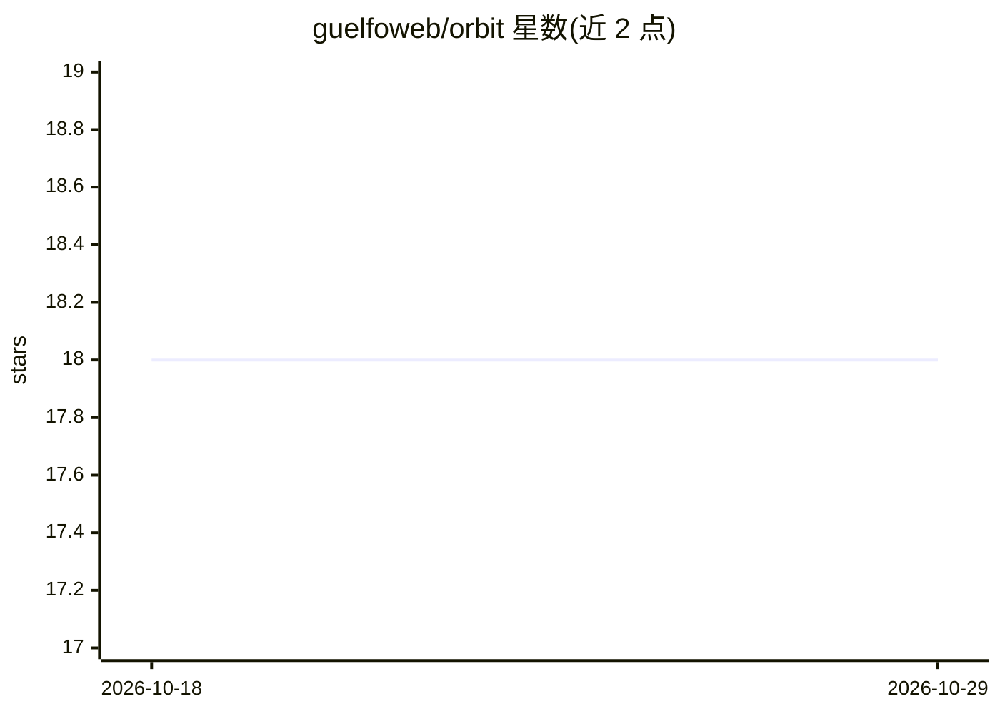

# guelfoweb/orbit

⭐ 18 · Python · MIT · 推送 2026-09-28 · [GitHub](https://github.com/guelfoweb/orbit) · 个人维护

**CPU 本地 agentic AI 运行时：本地聊天、工具调用与静态产物分析**

面向纯 CPU 消费级硬件的 Python 本地 AI 运行时，以内置 vendored 的 llama.cpp 后端负责分词、推理、流式与模型状态，无需单独安装 llama.cpp 或外部推理服务。终端客户端提供本地聊天、模型自选工具（可执行本地 shell 命令）、文件工作流与静态产物分析（ANALYSIS，生成的 Python 在 bubblewrap 沙箱中运行）。合格平台为 Linux x86_64，需 Python 3.11+、Git、CMake 与 C/C++ 工具链。提供模型注册表、多分片 GGUF 下载与恢复机制，README 明确区分后端合格与语义合格并记录分析局限。

## 筛选速览

| 维度 | 判定 | 备注 |
|---|---|---|
| AI 角色 | `ai-ecosystem` | LLM/agent 周边工具 |
| 许可风险 | `permissive` | MIT |
| 部署形态 | `None` |  |
| 模型依赖 | local-ok | 支持本地模型 |
| 硬件要求 | `cpu-ok` | |
| 安装摩擦 | `medium` | 含编译或系统依赖之一 |
| 成熟度 | — | 结构信号不足 |

## 能力要点

- 内置 vendored llama.cpp 后端，无需外部推理服务器
- 工具调用默认开启，模型自行决定何时执行本地命令
- ANALYSIS 产物分析在 bubblewrap 沙箱中运行，报告保留出处与未决问题
- 多分片 GGUF 下载支持断点续传与分片复用

## 适用场景

- 在没有 GPU 的 Linux 机器上本地运行 LLM 聊天与工具调用
- 对本地文件产物做沙箱化的自动调查分析
- 离线环境下运行经过注册表验证的量化模型

## 场景标签

`聊天机器人` `推理引擎` · 领域:对话与助手

## 证据(README 行号)

> L3: Orbit is a Python local-AI runtime for CPU-only machines. It combines local
> L7: The runtime manages tools, sessions, evidence, verification and bounded repair.
> L8: The integrated llama.cpp backend handles tokenization, inference, streaming and

## 星数曲线

2026-10-18 18 → 2026-10-29 18（+0）

---
*卡片 v1 · prompt 1.4 · 生成 2026-10-29 · 置信度 high · 依据 README sha `0a661177376a` · [字段定义](../../DATASET.md)*
