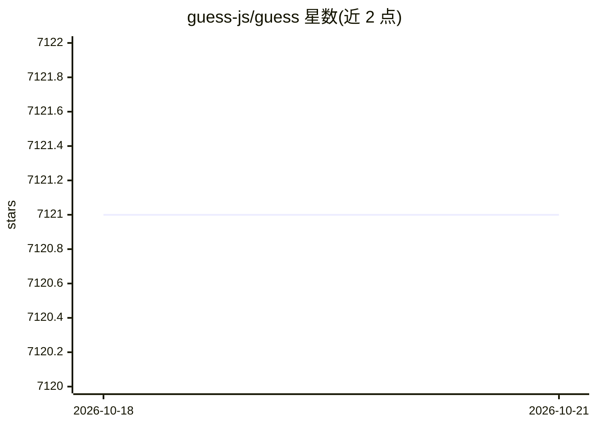

# guess-js/guess

⭐ 7,121 · TypeScript · MIT · 推送 2026-10-16 · [GitHub](https://github.com/guess-js/guess) · [官网](https://guess-js.github.io/) · 组织维护

**为 Web 开发者提供数据/ML 驱动的预测性预取工具库**

Guess.js 提供一组库与工具，用于在 Web 站点中实现预测性数据驱动的用户体验：基于 Google Analytics 导航数据（可选机器学习模型）预测用户下一步可能访问的页面，并执行页面级 prerender/prefetch 或打包级的 bundle 预取，以改善后续页面的加载性能。面向 Web 开发者，提供 webpack 插件（GuessPlugin）与非 webpack 的集成流程；仓库内含 ga、parser、webpack 三个子包。项目自标注为 alpha 阶段，ML 为可选增强而非初始实现的必需项。

## 筛选速览

| 维度 | 判定 | 备注 |
|---|---|---|
| AI 角色 | `ai-ecosystem` | LLM/agent 周边工具 |
| 许可风险 | `permissive` | MIT |
| 部署形态 | `None` |  |
| 模型依赖 | — | README 未给出锁定关系 |
| 硬件要求 | — | 无带数字的原话,不猜 |
| 安装摩擦 | `low` | 无编译、无系统依赖或容器化 |
| 成熟度 | `idea` | |

## 能力要点

- 基于 Google Analytics 会话数据预测用户下一页并预取
- 支持页面级 prerender/prefetch 与 bundle 级预取两种粒度
- 提供 GuessPlugin webpack 插件与三个独立子包（ga/parser/webpack）
- 面向非 webpack 用户的预测性预取集成流程

## 适用场景

- 为站点自动预取用户可能访问的下一个页面以提升加载体验
- 在 webpack 构建中按导航概率预取 JavaScript 代码块
- 利用站点分析数据驱动个性化的内容与组件展示

## 场景标签

 · 领域:Web 前端/性能优化

## 证据(README 行号)

> L30: Guess.js provides libraries & tools to simplify predictive data-analytics driven approaches to improving user-exper
> L81: ML could help improve the overall accuracy of a solution's predictions, but is not a necessity for an initial imple

## 星数曲线

2026-10-18 7,121 → 2026-10-21 7,121（+0）

---
*卡片 v1 · prompt 1.4 · 生成 2026-10-20 · 置信度 mid · 依据 README sha `d8ec754cf5e9` · [字段定义](../../DATASET.md)*
