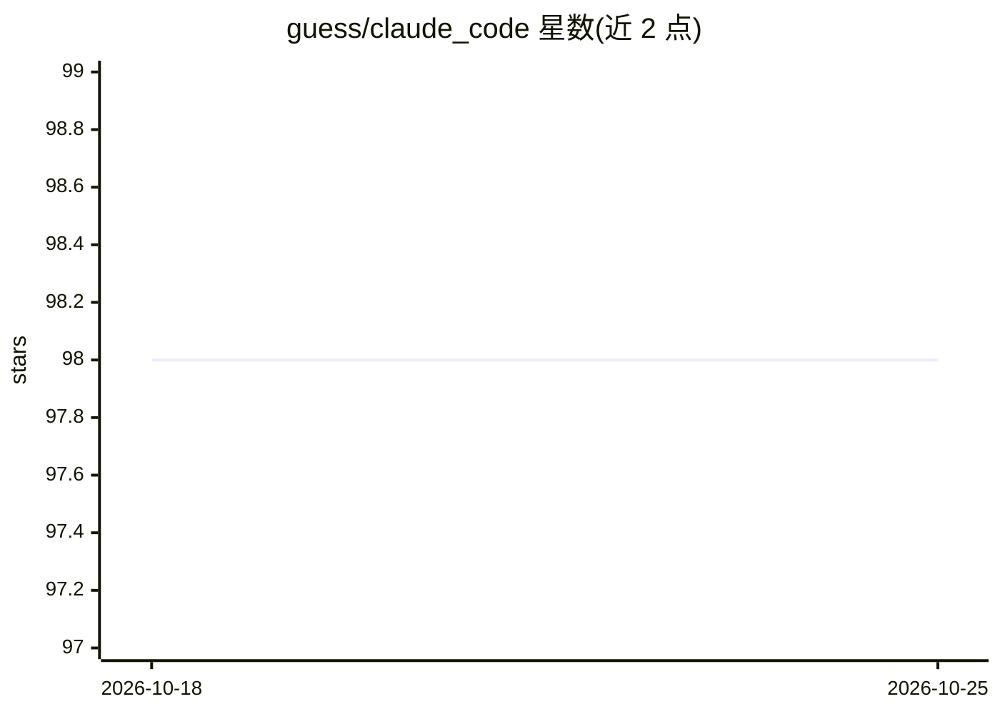

# guess/claude_code

⭐ 98 · Elixir · MIT · 推送 2026-06-05 · [GitHub](https://github.com/guess/claude_code) · [官网](https://code.claude.com) · 个人维护

**面向 Elixir 开发者的 Claude Agent SDK：OTP 构建 AI agent**

为 Elixir/BEAM 提供的 Claude Agent SDK，宣称与官方 Python/TypeScript SDK 功能对齐。会话实现为 GenServer，纳入标准 OTP 生命周期管理；提供原生 Elixir Streams 流式输出（含字符级增量）、BEAM 进程内自定义工具与 MCP 集成（stdio/HTTP/SSE/in-process）、子 agent、权限与钩子、结构化输出、成本控制、文件检查点与分布式会话（将 CLI 子进程卸载到远程节点）。CLI 二进制捆绑并在首次使用时自动安装。以 Hex 依赖安装，面向 Elixir 开发者。

## 筛选速览

| 维度 | 判定 | 备注 |
|---|---|---|
| AI 角色 | `ai-ecosystem` | LLM/agent 周边工具 |
| 许可风险 | `permissive` | MIT |
| 部署形态 | `None` |  |
| 模型依赖 | locked-api |  |
| 硬件要求 | — | 无带数字的原话,不猜 |
| 安装摩擦 | `low` | 无编译、无系统依赖或容器化 |
| 成熟度 | — | 结构信号不足 |

## 能力要点

- 会话为 GenServer，纳入标准 OTP 生命周期管理
- 原生 Elixir Streams 流式输出，支持背压与组合管道
- BEAM 进程内自定义工具，可直接访问 Ecto/GenServer/缓存
- 通过 Erlang 分布式将 CLI 子进程卸载到远程沙箱节点

## 适用场景

- 在 Phoenix LiveView 应用中流式展示 agent 响应
- 构建带进程内工具与权限控制的 OTP agent 服务
- 将 CLI 进程卸载到独立沙箱节点以扩展并发

## 场景标签

`Agent 框架` · 领域:Agent 开发

## 证据(README 行号)

> L3: The idiomatic Elixir SDK for building AI agents with Claude. Native streams, in-process tools, OTP lifecycle managem
> L33: - **Sessions are GenServers** – link to a LiveView, spawn per-request, or supervise as a service

## 星数曲线

2026-10-18 98 → 2026-10-25 98（+0）

---
*卡片 v1 · prompt 1.4 · 生成 2026-10-23 · 置信度 high · 依据 README sha `9134d9c05457` · [字段定义](../../DATASET.md)*
