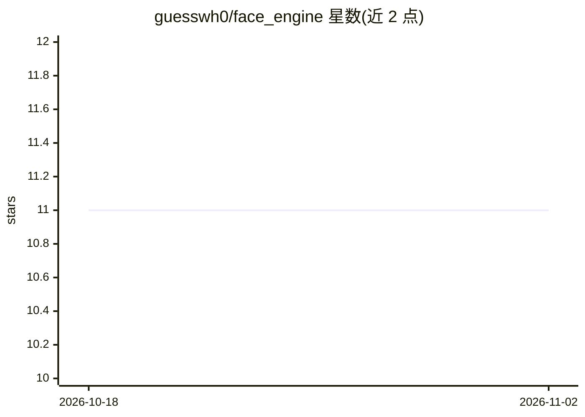

# guesswh0/face_engine

⭐ 11 · Python · Apache-2.0 · 推送 2026-10-30 · [GitHub](https://github.com/guesswh0/face_engine) · [官网](https://face-engine.readthedocs.io) · 个人维护

**Python 人脸识别库：检测、嵌入比对、活体检测接口**

轻量级 Python 库，为人脸识别任务提供统一接口：基于 Detector/Embedder/Estimator/Antispoof 四类模型接口组织能力，支持 fit 训练与 make_prediction 识别、find_faces/compute_embeddings、1:1 比对（compare 余弦相似度）及可选活体检测（minifasnet，非 ISO/IEC 30107-3 认证）。默认后端为 insightface（scrfd/arcface），dlib 为可选回退后端，用户可实现自定义模型。库代码 Apache-2.0，但 insightface 模型权重仅限非商业研究用途。要求 Python 3.11+，经 PyPI pip 安装。

## 筛选速览

| 维度 | 判定 | 备注 |
|---|---|---|
| AI 角色 | `ai-native` | 本体是模型或模型工具 |
| 许可风险 | `permissive` | Apache-2.0 |
| 部署形态 | `library` | 以包/库形式分发 |
| 模型依赖 | — | README 未给出锁定关系 |
| 硬件要求 | — | 无带数字的原话,不猜 |
| 安装摩擦 | `medium` | 含编译或系统依赖之一 |
| 成熟度 | — | 结构信号不足 |

## 能力要点

- 四类模型接口（Detector/Embedder/Estimator/Antispoof）支持用户自定义实现
- 1:1 人脸验证：compare 返回余弦相似度原始分数
- 可选活体/呈现攻击检测（minifasnet 集成，Apache-2.0 权重）
- 模型下载经 SHA-256 校验和验证；引擎持久化为 JSON 而非 pickle

## 适用场景

- 在 Python 应用中做人脸检测与身份识别
- 构建 1:1 人脸验证流程并自行校准阈值
- 增加针对照片与屏幕回放的活体检测步骤

## 场景标签

`人脸识别` · 领域:感知与多模态

## 证据(README 行号)

> L3: FaceEngine is a lightweight python library that provides an easy interface to
> L10:  >>> engine.fit(['bubbles1.jpg', 'drive.jpg'], [1, 2])
> L11:  >>> engine.make_prediction('bubbles2.jpg')

## 星数曲线

2026-10-18 11 → 2026-11-02 11（+0）

---
*卡片 v1 · prompt 1.4 · 生成 2026-11-02 · 置信度 high · 依据 README sha `e7b2f55fd99c` · [字段定义](../../DATASET.md)*
