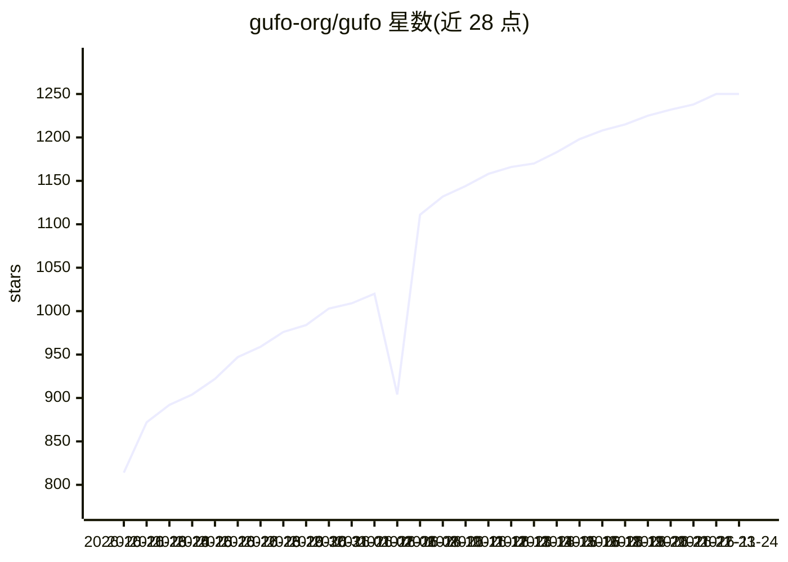

# gufo-org/gufo

⭐ 1,250 · C++ · MIT · 推送 2026-11-22 · [GitHub](https://github.com/gufo-org/gufo) · [官网](https://gufo.blog) · 组织维护

**面向 AMD Strix Halo 单机的开源推理引擎，提供 OpenAI 兼容 API**

针对 AMD Strix Halo（Ryzen AI MAX+ 395 / Radeon 8060S，gfx1151，最高 128 GiB 统一内存）的推理引擎，以单二进制形式提供文本、嵌入、语音、图像与视频模型的推理服务，暴露 OpenAI 兼容 API，并针对该芯片调优内核。内置面向 coding agent 长对话重发场景的缓存机制，支持通过扩展接入自带模型；每个模型附带质量报告，与独立参考实现对比。仅支持单机、每个用例一个模型；仅面向 Linux 与 Windows。

## 筛选速览

| 维度 | 判定 | 备注 |
|---|---|---|
| AI 角色 | `ai-ecosystem` | LLM/agent 周边工具 |
| 许可风险 | `permissive` | MIT |
| 部署形态 | `None` |  |
| 模型依赖 | local-ok | 支持本地模型 |
| 硬件要求 | — | 无带数字的原话,不猜 |
| 安装摩擦 | `low` | 无编译、无系统依赖或容器化 |
| 成熟度 | `idea` | |

## 能力要点

- 单二进制提供文本、嵌入、语音、图像、视频模型的 OpenAI 兼容 API
- 内核针对 Strix Halo（gfx1151，128 GiB 统一内存）调优
- 面向 coding agent 长对话的缓存机制
- 扩展注册表可安装额外模型（gufo extension install）

## 适用场景

- 在 Strix Halo 单机上本地部署文本/语音/图像/视频模型服务
- 为 coding agent 提供带缓存推理的本地 OpenAI 兼容 API
- 通过扩展注册表扩展可运行的自定义模型

## 场景标签

`推理引擎` · 领域:训练与推理

## 证据(README 行号)

> L10: Gufo is an open-source inference engine for one machine: AMD Strix Halo, the
> L13: OpenAI-compatible APIs, from a single binary with kernels tuned for that chip.

## 星数曲线

2026-10-21 814 → 2026-11-24 1,250（+436）

---
*卡片 v1 · prompt 1.4 · 生成 2026-11-23 · 置信度 high · 依据 README sha `c211817040e3` · [字段定义](../../DATASET.md)*
