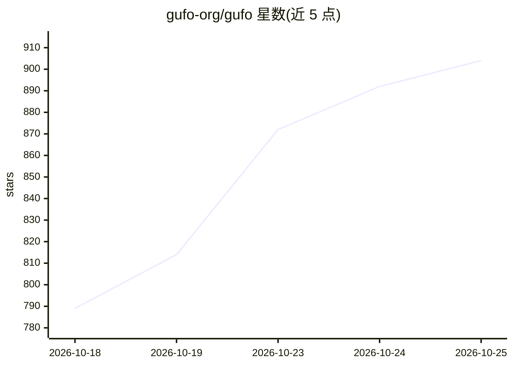

# gufo-org/gufo

⭐ 904 · C++ · MIT · 推送 2026-10-24 · [GitHub](https://github.com/gufo-org/gufo) · [官网](https://gufo.blog) · 组织维护

**面向 AMD Strix Halo 的本地推理引擎，运行文本/语音/图像/视频模型**

专为 AMD Strix Halo（Ryzen AI MAX+ 395，gfx1151，最高 128 GiB 统一内存）构建与优化的垂直本地推理引擎，以 HIP/ROCm 直接编译 GPU 内核。支持 Qwen3.8 27B/Flash-Next、DeepSeek V4 Flash 等文本模型（含 DFlash2/MTP 投机解码）、ASR、TTS、图像生成与文生视频，提供 OpenAI 兼容 API（Chat Completions 与 Responses）。构建路径为 Nix 或 CMake 源码编译，依赖 ROCm 7.2.3 等系统库；限定 Linux x86-64 目标，Qwen 与 Claude Code 的组合声明不支持。并发请求、取消与对话缓存被列为首要工作负载。

## 筛选速览

| 维度 | 判定 | 备注 |
|---|---|---|
| AI 角色 | `ai-ecosystem` | LLM/agent 周边工具 |
| 许可风险 | `permissive` | MIT |
| 部署形态 | `None` |  |
| 模型依赖 | — | README 未给出锁定关系 |
| 硬件要求 | — | 无带数字的原话,不猜 |
| 安装摩擦 | `high` | 编译与系统依赖俱全 |
| 成熟度 | — | 结构信号不足 |

## 能力要点

- 专为 Strix Halo 128 GiB 统一内存优化，HIP 直编内核，不依赖 Python/Triton 运行时
- OpenAI 兼容 API，支持文本、图像、函数工具、结构化输出与流式
- 覆盖 LLM、ASR/TTS、图像生成、文生视频多模态模型
- 提供各模型独立的质量报告与基准数据

## 适用场景

- 在 Strix Halo 机器上本地运行 27B 级量化模型服务
- 通过 OpenAI 兼容接口接入 Open WebUI、VS Code、Codex 等客户端
- 本地运行语音识别、语音合成与图像生成

## 场景标签

`推理引擎` · 领域:训练与推理

## 证据(README 行号)

> L5: Gufo is a vertical local inference engine specifically built and optimized for the AMD Strix Halo hardware:
> L6: Ryzen AI MAX+ 395 systems with Radeon 8060S (`gfx1151`), up to 128 GiB of unified memory.
> L40: - Build and optimize specifically for the Strix Halo 128 GiB hardware. Smaller memory configurations should still w

## 星数曲线

2026-10-18 789 → 2026-10-25 904（+115）

---
*卡片 v1 · prompt 1.4 · 生成 2026-10-22 · 置信度 high · 依据 README sha `e9f7efd02fb1` · [字段定义](../../DATASET.md)*
