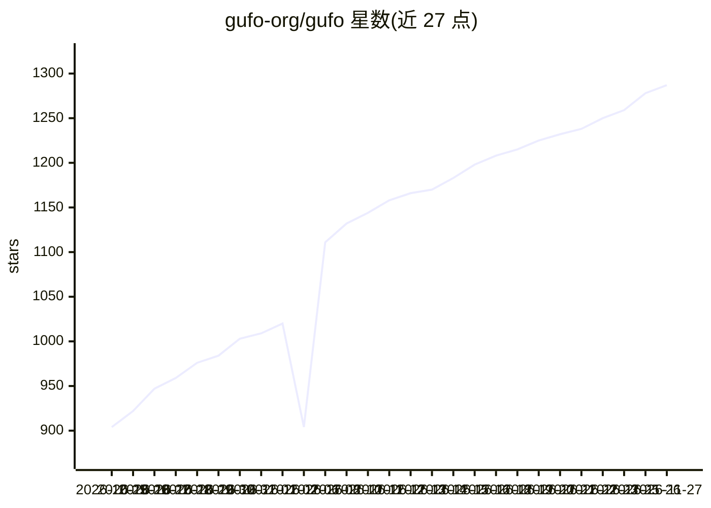

# gufo-org/gufo

⭐ 1,287 · C++ · MIT · 推送 2026-11-26 · [GitHub](https://github.com/gufo-org/gufo) · [官网](https://gufo.blog) · 组织维护

**AMD Strix Halo 专用推理引擎：单二进制服务多种模型**

面向单台 AMD Strix Halo（Ryzen AI MAX+ 395，gfx1151，最高 128 GiB 统一内存）的开源推理引擎，以单个二进制提供文本、嵌入、语音（ASR/TTS）、图像与视频模型的 OpenAI 兼容 API；针对该芯片调优内核，为编码 agent 的长对话重发场景提供缓存，扩展机制可接入第三方模型。运行于 Linux（发布版经构建测试）与原生 Windows；每个模型附质量报告，与独立参考输出比对。Gufo 代码为 MIT，模型权重沿用各自发布方许可（部分为非商业许可）。

## 筛选速览

| 维度 | 判定 | 备注 |
|---|---|---|
| AI 角色 | `ai-ecosystem` | LLM/agent 周边工具 |
| 许可风险 | `permissive` | MIT |
| 部署形态 | `None` |  |
| 模型依赖 | local-ok | 支持本地模型 |
| 硬件要求 | — | 无带数字的原话,不猜 |
| 安装摩擦 | `low` | 无编译、无系统依赖或容器化 |
| 成熟度 | — | 结构信号不足 |

## 能力要点

- 单二进制提供文本/嵌入/语音/图像/视频模型的 OpenAI 兼容 API
- 针对 AMD Strix Halo（gfx1151）与 128 GiB 统一内存调优内核
- 为编码 agent 长对话重发设计的缓存
- 扩展注册表支持安装第三方模型扩展

## 适用场景

- 在 Strix Halo 单机上本地部署文本、语音、图像、视频模型服务
- 为编码 agent 提供带缓存的 OpenAI 兼容推理端点
- 通过扩展注册表接入社区模型

## 场景标签

`推理引擎` · 领域:训练与推理

## 证据(README 行号)

> L10: Gufo is an open-source inference engine for one machine: AMD Strix Halo, the
> L12: unified memory. It serves text, embedding, speech, image and video models over
> L13: OpenAI-compatible APIs, from a single binary with kernels tuned for that chip.

## 星数曲线

2026-10-25 904 → 2026-11-27 1,287（+383）

---
*卡片 v1 · prompt 1.4 · 生成 2026-11-26 · 置信度 high · 依据 README sha `8600fcd41769` · [字段定义](../../DATASET.md)*
