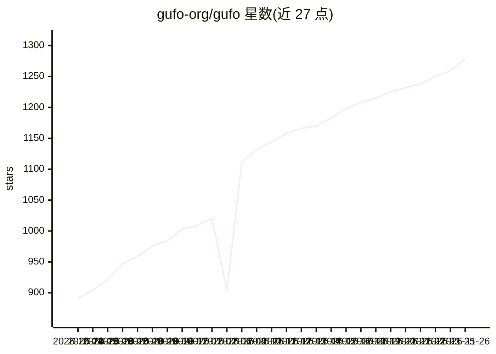

# gufo-org/gufo

⭐ 1,278 · C++ · MIT · 推送 2026-11-25 · [GitHub](https://github.com/gufo-org/gufo) · [官网](https://gufo.blog) · 组织维护

**面向 AMD Strix Halo 单机的开源 AI 推理引擎**

Gufo 是针对 AMD Strix Halo（Ryzen AI MAX+ 395，gfx1151，最高 128 GiB 统一内存）的推理引擎，以单个二进制通过 OpenAI 兼容 API 提供文本、嵌入、语音、图像和视频模型服务，支持 Linux 与 Windows。每个用例只跑一个模型，并为该芯片调优内核；缓存面向编码 agent 重发长对话的场景，扩展机制可接入自定义模型，模型优化附质量报告。代码 MIT 许可，模型权重遵循各自发布方条款。

## 筛选速览

| 维度 | 判定 | 备注 |
|---|---|---|
| AI 角色 | `ai-ecosystem` | LLM/agent 周边工具 |
| 许可风险 | `permissive` | MIT |
| 部署形态 | `None` |  |
| 模型依赖 | local-ok | 支持本地模型 |
| 硬件要求 | — | 无带数字的原话,不猜 |
| 安装摩擦 | `low` | 无编译、无系统依赖或容器化 |
| 成熟度 | — | 结构信号不足 |

## 能力要点

- 单二进制提供文本、嵌入、语音、图像、视频模型的 OpenAI 兼容 API
- 内核针对 Strix Halo 芯片调优，每个模型附独立参照的质量报告
- 面向编码 agent 长对话的缓存机制与扩展注册表
- 支持 MTP 投机解码与并发请求、取消等真实负载

## 适用场景

- 在 Strix Halo 单机上本地服务 LLM 并接入 OpenAI 客户端
- 为编码 agent 提供带长对话缓存的本地推理后端
- 在统一内存设备上运行 ASR、TTS 与图像/视频生成模型

## 场景标签

`推理引擎` `语音识别` `语音合成` `图像生成` · 领域:内容生成

## 证据(README 行号)

> L10: Gufo is an open-source inference engine for one machine: AMD Strix Halo, the
> L13: OpenAI-compatible APIs, from a single binary with kernels tuned for that chip.
> L83: Any OpenAI client works with the base URL `http://localhost:8080/v1`: Open

## 星数曲线

2026-10-24 892 → 2026-11-26 1,278（+386）

---
*卡片 v1 · prompt 1.4 · 生成 2026-11-25 · 置信度 high · 依据 README sha `4affca938dec` · [字段定义](../../DATASET.md)*
